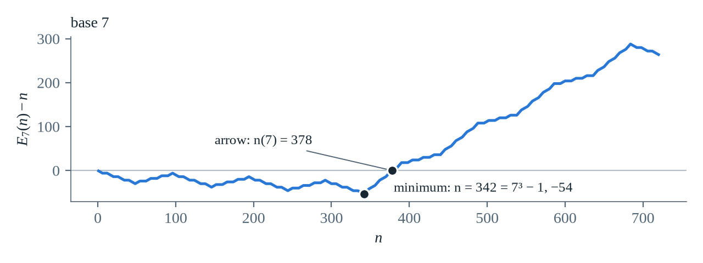
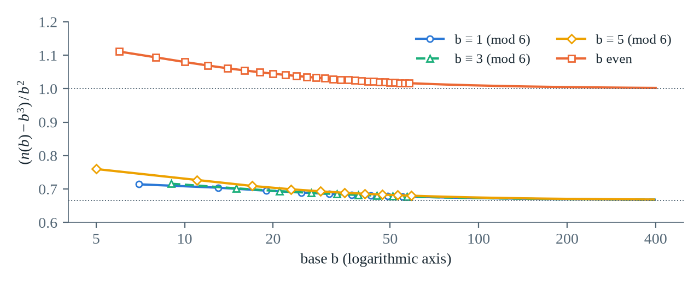
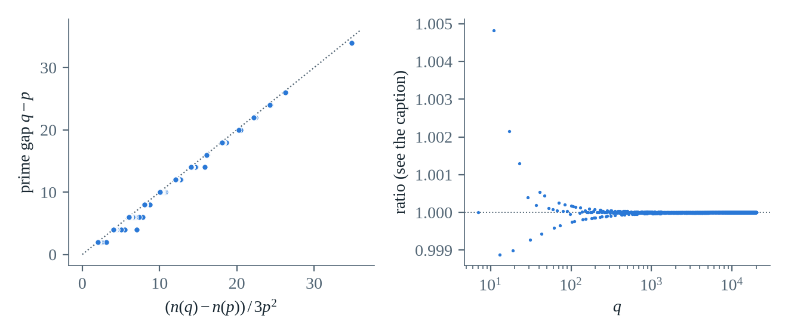
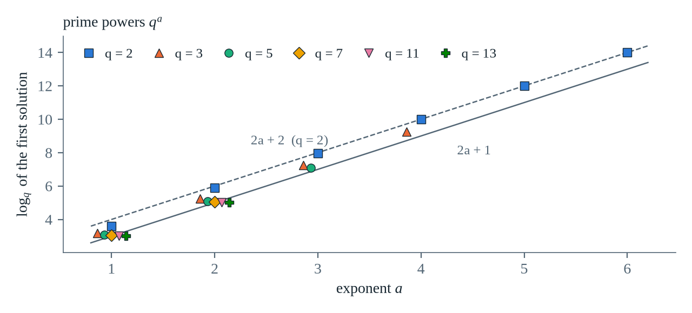

# FactorX

James Augustus · ORCID [0009-0002-7286-7730](https://orcid.org/0009-0002-7286-7730)

The universe language of numbers and its main example: Bow Draw

Version 1.0, 23 November 2026 · DOI [10.5281/zenodo.24451375](https://doi.org/10.5281/zenodo.24451375)

## Abstract

FactorX is a language that describes numbers with three states: nothing (0), existence (1) and duality (two existences side by side, `11`). The written world of one base is called a universe. A digit may hold a number larger than the base. In this language every number n ≥ 2 is the first pair of the universe with base n − 1: n = `[1][1]_(n−1)`. The number of universes in which n appears is τ(n) − 1, where τ(n) is the number of divisors of n. A prime is a number that appears in exactly one universe, as its own first pair. So the language has a single prime form: `[1][1]`. Two classical facts are also written in the same language (Sections 3.3, 3.4 and 3.6). When two numbers with ordinary digits are added, every carry is 0 or 1. For a composite d, row d − 1 of Pascal's triangle read modulo d first leaves the pattern C(d − 1, j) ≡ (−1)^j at the column r = b + 1, where b is the smallest universe in which d appears as a copy. For a prime d the row never leaves it.

The main example is Bow Draw. In the universe b, for every row k ≥ 1 of Pascal's triangle, the two halves ⌊k/2⌋ and ⌈k/2⌉ are added and the carries are counted. Let E_b(n) be the total number of carries over the rows 1 to n. When b is a prime p, Kummer's theorem says that E_p(n) is the exponent of p in the product c(1)·c(2)···c(n) of the central binomial coefficients c(k) = C(k, ⌊k/2⌋). The difference E_b(n) − n first falls, reaches a minimum near b³, then rises and crosses zero (for even b ≥ 4 this shape is measured, not proved). I call the crossing point the Bow Draw point n(b). It is given exactly by a formula that depends only on b modulo 6. For example n(b) = b³ + b² + b − 2 for every even b, and n(7) = 378.

I prove that E_b(n(b)) = n(b) for every base b ≥ 2 by a computer-assisted proof with polynomial certificates. For every odd base and for b = 2 I also prove by hand that n(b) is a solution, that it is the only one, and that E_b(n) − n changes sign only there. So for every prime base the result needs no computer. For even bases b ≥ 4 the uniqueness is measured, not proved: for every base b < 2000 I counted every n up to 3b³ + 300.

As a test of the programs, the location formula was also checked with exact integer arithmetic for all primes 5 ≤ p < 10¹⁰ (the bases 2 and 3 are counted directly), for 12 000 random primes with 20 to 200 digits, and for the known Mersenne primes 2^e − 1 with 3 ≤ e ≤ 136 279 841. These are 51 of the 52 Mersenne primes known on 22 November 2026 (list of GIMPS [7]): all except the smallest one, 2² − 1 = 3, whose base 3 is counted directly. For a composite m, the exponent of m in c(1)···c(n) is a different quantity. For square-free m the equation K_m(n) = n (Section 6.7) has exactly one solution, at the point of the largest prime factor.

The Bow Draw law holds in the same form in every universe and does not use primality. So neither Bow Draw nor the theorems of the language are a primality test or a factoring method. The theorems of the language restate classical facts. The language only offers a way of writing them with one form and three states.

## 1. Purpose and scope

The purpose of FactorX is to describe divisibility and prime exponents in the language of positional writing itself. Whether a number is prime or composite is stated by the universes in which it appears and by the form it takes there. Section 2 gives the language and Section 3 its three theorems.

Bow Draw is the main example of this language and makes up most of the text (Sections 4 to 9). The question is simple to state. Count the carries row by row. After how many rows does the total number of carries equal the number of rows? I answer it for every base b ≥ 2, with a proof of uniqueness for odd b and b = 2. I give the definitions, the location formula, the proofs, small and large worked examples and the programs that reproduce every number. I also describe where the crossing points of different bases lie relative to each other.

I do not describe a primality test, a factoring method or a hardware design. Where a statement rests only on counting over a finite range, I say so and give the range. In Appendix A I give, in my own words, the intuitions that led to these results and the starting point of the work.

## 2. The universe language

**Two words, two senses.** In this text "even" and "prime" are also used in my own language.

**Even (duality).** Two existences side by side, `11`. In every universe counting starts at 0 and, after `10`, reaches `11`. That `11` is the first pair of the universe: `[1][1]_b` = b + 1. A number is even in a universe if it is the first pair of that universe or a copy of it, that is a multiple of it. Ordinary evenness is one case: evenness in the universe of 2 (b = 1). 2 = `[1][1]_1` is the first `11` of our counting, the smallest pair.

**Prime.** We usually find primes by trying, one by one. In this language they all stand at the same place: the `11` of a universe. In my intuition the prime of a universe is its `11`. A prime in the ordinary sense is a number that appears as `11` only in its own universe (Theorem 1). For example 4 = `[1][1]_3` is the `11` of the universe of 3, but it also appears as `[2][2]_1` in the universe of 2, so it is not a prime in the ordinary sense. 2 is a prime in the ordinary sense as well: it appears only in its own universe.

| word | meaning | example |
|---|---|---|
| nothing | 0 | |
| existence | 1 | |
| duality | two existences side by side, `11` | 2 = `[1][1]_1` |
| universe b | writing in base b, b ≥ 1 | the universe of 13 is b = 12 |
| digit | one place of a base. It may be wide: it holds any value x ≥ 0. `[x][y]_b` = x·b + y | `[3][3]_2` = 9 |
| first pair | `[1][1]_b` = b + 1 | 13 = `[1][1]_12` |
| copy | `[a][a]_b` = a·(b + 1), a ≥ 2 | 12 = `[2][2]_5` |
| universe of r | the universe in which r is the first pair, b = r − 1 | the universe of 17 is b = 16 |
| even (in a universe) | n is even in the universe of r: n is the first pair of r or a copy of it, that is a multiple of r | 3587 is even in the universe of 17 |
| τ(n) | the number of divisors of n, 1 and n included | τ(12) = 6 |

Writing with wide digits is not unique. The same number can be written in several ways in one base. Here I use only the two-digit form `[a][a]_b`. The universe b = 1 is allowed as well: `[a][a]_1` = 2a.

The status of each statement is given by the following labels.

| Label | Meaning |
|---|---|
| HOLDS (proof) | Proved in this note by a written argument |
| HOLDS (computer-assisted proof) | Proved in this note. One step is a finite set of polynomial inequalities checked by a program in exact arithmetic |
| MEASURED | Counted by a program over the stated range only. No proof |
| UNTESTED | Neither proved nor counted |

Program runs report PASS or FAIL.

## 3. Three theorems of the language

### 3.1 Every number is a first pair

**Theorem 1** (HOLDS, proof). Let n ≥ 2. For a ≥ 1 and b ≥ 1, the equation n = `[a][a]_b` holds if and only if b + 1 divides n and a = n/(b + 1). Therefore:

1. Every n is the first pair of the universe b = n − 1: n = `[1][1]_(n−1)`.
2. The number of universes in which n appears is τ(n) − 1.
3. n appears in exactly one universe if and only if n is prime.

*Proof.* `[a][a]_b` = a·b + a = a·(b + 1). So n = `[a][a]_b` means a·(b + 1) = n. Every divisor d of n with 2 ≤ d ≤ n gives exactly one universe: b = d − 1 and a = n/d. Leaving out the divisor 1, there are τ(n) − 1 such divisors. The divisor d = n gives item 1. Finally τ(n) − 1 = 1 means τ(n) = 2, which is the statement that n is prime. ∎

### 3.2 One prime form

By Theorem 1 all primes have the same form: they appear as `[1][1]` in their own universe and in no other universe. A composite number appears in this form and also as a copy in at least one universe. In this language there is a single prime form, `[1][1]`. The primes in the ordinary sense are the numbers that appear only in this form.

The first even number is 2, and 2 = `[1][1]_1`. Every even number n is written n = `[n/2][n/2]_1`: in the universe of 2 it is the first pair (n = 2) or a copy of it (n ≥ 4). Evenness in the ordinary sense is evenness in the universe of 2. In the same way the multiples of 3 are even in the universe of 3 (b = 2): 9 = `[3][3]_2`.

**Why wide digits are needed.** If digits are kept ordinary, smaller than the base (a < b), item 3 of Theorem 1 fails. The composite numbers that are a copy in no universe with ordinary digits are exactly 6 and the prime squares (HOLDS, proof; 87 numbers between 4 and 200 000). The proof follows Schott [9, pp. 32, 36]. Let n be composite, p its smallest prime factor and m = n/p ≥ p. If m ≥ p + 2, then n = `[p][p]_(m−1)` with the ordinary digit p ≤ m − 2. If m = p, then n = p², and a(b + 1) = p² has no solution with 2 ≤ a < b. If m = p + 1, then every prime factor of m is at least p and m < 2p ≤ p², so m is prime; p and p + 1 are both prime only for p = 2, so n = 6, which has no such form either. For example 9 = 3·3 cannot be written as a copy, that is as `aa` with a ≥ 2, in any base with ordinary digits. With a wide digit 9 = `[3][3]_2`. With ordinary digits, and with a digit repeated any number of times, this question is known under the name of Brazilian numbers [9] (OEIS A125134 [3]).

### 3.3 Addition never leaves 0, 1 and 2

**Theorem 2** (HOLDS, proof). When two numbers written with ordinary digits (every digit between 0 and b − 1) are added in a base b ≥ 2, the carry at every digit is 0 or 1. With wide digits this fails: in base 2, `[3][3]` + `[3][3]` gives 6 in the last digit and a carry of 3.

*Proof.* The carry into the first digit is 0. If the carry into a digit is at most 1, the value added at that digit is at most (b − 1) + (b − 1) + 1 = 2b − 1. Since 2b − 1 < 2b, the carry passed to the next digit does not exceed ⌊(2b − 1)/b⌋ = 1. By induction every carry is 0 or 1. ∎

In this language, at every digit the overflow is either absent (nothing) or a single existence. What is added to a full digit and does not fit moves to the next digit as a single existence. In 200 000 random additions in bases 2 to 999, with numbers below 10³⁰, the largest carry is 1 (MEASURED).

### 3.4 A row of Pascal's triangle shows the first universe of a number

Let d ≥ 2. Let b be the smallest universe in which d appears, and put r = b + 1. By Theorem 1, r is the smallest divisor of d greater than 1. So r is the smallest prime factor of d. If d is prime, r = d.

**Theorem 3** (HOLDS, proof). In row d − 1 of Pascal's triangle, C(d − 1, j) ≡ (−1)^j (mod d) for every j < r. If d is composite, the congruence first fails at the column j = r. Later columns may fail as well (d = 4: j = 2 and 3). If d is prime, the row never breaks.

*Proof.* C(d − 1, j) is the product of the factors (d − i)/i for i = 1 to j. If i is coprime to d, then (d − i)·i⁻¹ ≡ −1 modulo d. Every i < r is coprime to d. So C(d − 1, j) ≡ (−1)^j for j < r. If d is prime, r = d and every column of the row satisfies j ≤ d − 1 < r.

Let d be composite and suppose the congruence also holds at j = r. Then C(d, r) = C(d − 1, r) + C(d − 1, r − 1) ≡ (−1)^r + (−1)^(r−1) = 0 (mod d). On the other hand C(d, r) = (d/r)·C(d − 1, r − 1). Since C(d − 1, r − 1) ≡ ±1 (mod d), r does not divide this number. So the exponent of r in C(d, r) is exactly one less than its exponent in d, and d cannot divide C(d, r). This is a contradiction. ∎

In this language: row d − 1 runs 1, −1, 1, −1, … and first breaks at column r. Here r is the first pair of the smallest universe b = r − 1 in which d appears as a copy, that is the first universe in which d is even. A prime appears only in its own universe, so its row never breaks.

### 3.5 Bow Draw in this language

In the universe b, for every row k ≥ 1, the two halves of k, ⌊k/2⌋ and ⌈k/2⌉, are added and the overflows are counted. By Theorem 2 every overflow is a single existence. E_b(n) is the total number of overflows in the rows 1 to n. Sections 4 to 7 treat this in detail. The results are:

1. The number n(b) with E_b(n) = n exists for every b ≥ 2 (Theorem 4, HOLDS, computer-assisted proof).
2. This solution is unique for every odd b and for b = 2 (Theorem 5, HOLDS, proof). For even b ≥ 4 uniqueness was counted for every b < 2000 (MEASURED).
3. n(b) is a polynomial that depends only on b modulo 6.

| universe b | 7 | 9 | 10 |
|---|---|---|---|
| kind of b | prime | composite, odd | composite, even |
| n(b) | 378 | 787 | 1108 |

The law does not look at whether b is prime. It has the same form in prime, composite, odd and even universes. When b is a prime p, E_p(n) is the exponent of p in the product c(1)·c(2)···c(n) (Kummer [1]). Primality appears only when one counts the universes in which a number appears (Theorem 1). So Bow Draw is not a primality test.

### 3.6 Related work

The content of the results in this section is classical. I write them in the universe language, but I do not claim a new theorem here. On 22 November 2026 I searched the OEIS, zbMATH Open, arXiv, Crossref and a general web search engine, looked through Chapter IX of Dickson's History [15] and consulted the works cited below.

That every n ≥ 3 is `11` in base n − 1 is known: it is the reason why the definition of Brazilian numbers asks for b < n − 1 (Schott [9, p. 30]; comments in OEIS A125134 and A167782 [3]). With ordinary digits the digit a of a two-digit form `aa` is a divisor of n [9, §II.1]. A220136 counts all repdigit forms with 1 < b < n − 1, and a comment in A326387 gives τ(n)/2 − 1 two-digit forms for a composite n that is neither a square nor the product of two consecutive numbers [3]. With wide digits the count becomes τ(n) − 1, the number of proper divisors (A032741 [3]). Item 3 of Theorem 1 restates Euclid's definition of a prime as a number measured by a unit alone [16, Def. 11]. The count in Section 3.2 (6 and the prime squares) follows from the proof of Schott's Theorem 1 and from his Lemma 1 [9, pp. 32, 36]. Digits outside 0, …, b − 1 and the non-unique writings they bring are known in positional notation (Knuth [22, §4.1]). I did not find the name "wide digit" in the sources I consulted.

Theorem 2 is a familiar fact: when two numbers with ordinary digits are added, every carry is 0 or 1. It appears in Kummer's carry equations as reported by Dickson [15, p. 270], and in the work of Diaconis and Fulman [21].

Theorem 3 is equivalent, by Pascal's rule, to the known statement that the least k with n ∤ C(n, k) is the least prime factor of n (a comment in OEIS A020639 [3]). Its key step, that q^k does not divide C(n, q) when q is a prime and q^k ‖ n, is in the proof of Lemma 2.1 of [17]. Sondow proved the same kind of least-prime-factor test for C(m + ℓ, ℓ) modulo m [18]. Since a composite d has r ≤ √d, Theorem 3 also gives the √d bound below; the same deduction for Babbage's test is Corollary 1 of [18]. The greatest common divisor of C(n, 1), …, C(n, n − 1) is larger than 1 only when n is a prime power (Ram, as reported in [15, p. 274]).

For a prime d the row runs 1, −1, 1, … (Lucas [8]). The converse is Problem 1494 of Deutsch and Gessel [10], and about √d columns are enough to decide (Cai [11]). I know these three results as quoted by Meštrović [12], not from the original papers. The paper [11] was printed under the names T. X. Cai and A. Granville; an erratum in the same journal states that A. Granville is not an author [13].

I did not find the wording of Theorem 3 for the row d − 1 in these sources, but given them I regard it as a restatement of known facts. What the language adds is a way of writing these results with one form (`[1][1]`) and three states. If an earlier source is pointed out to me, I will add it in the next version.

Related work for Bow Draw is in Section 6.6.

### 3.7 Small examples

| n | universes | written as | result |
|---|---|---|---|
| 7 | 1 | `[1][1]_6` | prime |
| 9 | 2 | `[1][1]_8`, `[3][3]_2` | even in the universe of 3 |
| 12 | 5 | `[1][1]_11`, `[2][2]_5`, `[3][3]_3`, `[4][4]_2`, `[6][6]_1` | τ(12) − 1 = 5 |
| 17 | 1 | `[1][1]_16` | prime |

### 3.8 Boundary cases

n = 2 appears only in the universe b = 1: 2 = `[1][1]_1`. 2 is prime and it is the first pair (the first `11`). n = 4 appears in two universes: `[1][1]_3` and `[2][2]_1`. 4 = 2·2 is the smallest prime square.

### 3.9 A case that ordinary digits cannot write

6 = 2·3 is a copy in no universe with ordinary digits. In `[2][2]_2` the digit 2 equals the base. In `[3][3]_1` the digit 3 is larger than the base. With wide digits both are valid, and 6 appears in three universes (τ(6) − 1 = 3). By the count in Section 3.2, with ordinary digits this happens only for 6 and for the prime squares.

### 3.10 Large examples

2⁶¹ − 1 = 2 305 843 009 213 693 951 is prime (Pervushin, 1883 [7]). So it appears in one universe only: `[1][1]_2305843009213693950`.

2⁶⁷ − 1 = 147 573 952 589 676 412 927 = 193 707 721 · 761 838 257 287 (Cole, 1903 [23]), where both factors are prime. Since τ = 4, the number appears in three universes:

```text
[1][1]_147573952589676412926
[193707721][193707721]_761838257286
[761838257287][761838257287]_193707720
```

For the Pascal row take 3587 = 17 · 211. Row 3586 modulo 3587 runs 1, −1, 1, … up to column 16 and breaks at column 17. For d = 1 022 117 = 1009 · 1013, row 1 022 116 breaks at column 1009.

## 4. Bow Draw: definitions and notation

From this section to the end of Section 7, digits are ordinary digits: in base b every digit lies between 0 and b − 1.


### 4.1 Base, digits and carries

A base is an integer b ≥ 2. Every integer x ≥ 0 has digits 0 to b − 1 in base b. When x and y are added digit by digit, a carry occurs at a position when the digit sum there, together with the incoming carry, is at least b. The number of carries is written carries_b(x, y).

The carry into position i equals ⌊(x + y)/b^i⌋ − ⌊x/b^i⌋ − ⌊y/b^i⌋. This gives the identity

```text
carries_b(x, y) = Σ_{i ≥ 1} ( ⌊(x + y)/b^i⌋ − ⌊x/b^i⌋ − ⌊y/b^i⌋ )    (4.1)
                = ( s_b(x) + s_b(y) − s_b(x + y) ) / (b − 1)    (4.2)
```

where s_b(x) is the sum of the digits of x in base b. Both forms hold for every base, prime or composite.

### 4.2 Rows, central coefficients and the carry sum

Pascal rows are numbered from k = 0. Row k has k + 1 entries. The central coefficient of row k is its largest entry (OEIS A001405 [3]):

```text
c(k) = C(k, ⌊k/2⌋)

k      1   2   3   4    5    6    7    8     9    10
c(k)   1   2   3   6   10   20   35   70   126   252
```

For k ≥ 1 the carry count of row k in base b is

```text
κ_b(k) = carries_b(⌊k/2⌋, ⌈k/2⌉)
```

and the carry sum up to row n is

```text
E_b(n) = κ_b(1) + κ_b(2) + ... + κ_b(n)
E_b(0) = 0
D_b(n) = E_b(n) − n
```

D_b(n) is the difference between the accumulated carries and the number of rows.

### 4.3 Kummer's theorem

For a prime p and an integer N ≥ 1, v_p(N) denotes the exponent of p in N, that is the largest e with p^e dividing N. The exponent v_p(C(x + y, x)) equals carries_p(x, y) [1] (see also the survey of Granville [19]). Therefore κ_p(k) is the exponent of p in c(k), and E_p(n) is the exponent of p in the product c(1)·c(2)···c(n).

Example with p = 3 and k = 10. The two halves are 5 and 5, and 5 = 12 in base 3.

```text
      1 2
    + 1 2
    -----
    2 + 2 = 4 ≥ 3            carry 1
    1 + 1 + 1 = 3 ≥ 3        carry 2
```

There are two carries. Indeed c(10) = 252 = 4 · 9 · 7, and the exponent of 3 is 2.

For a composite base b, E_b(n) is still a well-defined carry count, but it is not the exponent of b in the product. The exponent of a composite m is a different function, called K_m(n) in Section 6.7.

### 4.4 Bow Draw point

I call the number n(b) given by formula (6.1) the Bow Draw point of b. Theorem 4 shows that E_b(n(b)) = n(b) for every b ≥ 2. For odd b and for b = 2 it is the only solution (Theorem 5). For even b ≥ 4 no other solution was found in the counted range (Section 6.1). The name describes the shape of D_b. The difference first goes down, like a bow being drawn. It reaches its lowest point near b³. Then it rises and crosses zero at n(b), which is where the arrow lands.

## 5. Bow Draw: method

### 5.1 Direct counting

The first method follows the definition. For each n from 1 to a bound N, the program adds the two halves of n in base b digit by digit and adds the carries to a running total. It records every zero of D_b(n), the sign of D_b(n) before and after the first zero, and the position and value of the minimum. The bound used throughout is N = 3b³ + 300, about three times the expected crossing point. This method does not use any formula. It is implemented in `tests/check_small.py` and `tests/c/bow_draw_scan.c`.

### 5.2 Closed form

The second method computes E_b(n) for one n without visiting the rows before it. Define, for the base b,

```text
f(m)     = Σ_{i ≥ 1} ⌊m / b^i⌋
g(n, q)  = Σ_{k=1..n} ⌊k / q⌋ = q · a(a − 1)/2 + a(r + 1)
           where n = a·q + r, 0 ≤ r < q
S(n)     = f(1) + f(2) + ... + f(n) = Σ_{i ≥ 1} g(n, b^i)
```

By (4.1), κ_b(k) = f(k) − f(⌊k/2⌋) − f(⌈k/2⌉). Summing over k gives

```text
E_b(n)  = S(n) − T(n)
T(2m)   = 4·S(m) − f(m)
T(2m+1) = T(2m) + f(m) + f(m + 1)    (5.1)
```

T(n) is the sum of f(⌊k/2⌋) + f(⌈k/2⌉) over k = 1 to n. For n = 2m, the even rows k = 2j contribute 2f(j) for j = 1 to m. The odd rows k = 2j + 1 contribute f(j) + f(j + 1) for j = 0 to m − 1. Together this is 2S(m) + (S(m) − f(m)) + S(m) = 4S(m) − f(m). The odd case adds row 2m + 1.

The formula for g counts the k with ⌊k/q⌋ = j. For 1 ≤ j < a there are q of them, and for j = a there are r + 1. Each value of E_b(n) costs O(log_b n) operations on integers of the size of n. For a prime p, f(m) is the exponent of p in m! (Legendre's formula [2]).

Example with b = 7 and n = 378, so m = 189: S(378) = 11 388, S(189) = 2760, f(189) = 30, T(378) = 4 · 2760 − 30 = 11 010, and E_7(378) = 11 388 − 11 010 = 378.

### 5.3 Block scan on a graphics card

The third method repeats the direct count on a graphics card with Vulkan compute shaders, as an independent implementation. The card keeps ⌊n/2⌋ and ⌈n/2⌉ as arrays of base-b digits. From n to n + 1 exactly one of the two halves increases by one, so no division is needed. The card splits the range into blocks of 256 consecutive n. For each block it returns the sum of κ_b(n) − 1 and the smallest and largest partial sum inside the block. The processor adds the blocks in order, so it knows D_b at every block boundary. It then recounts on the processor every block in which a zero is possible, and the block that contains the minimum. The program is `tests/gpu/bow_draw_gpu.c` with the shader `tests/gpu/bow_draw_block64.comp`. It uses 64-bit integers.

### 5.4 Polynomial certificates

The fourth method proves existence. Write b = 12t + r with r one of 0 to 11. In each of the twelve classes, n(b) from (6.1) is a polynomial in t with rational coefficients. Every floor ⌊x(t)/q(t)⌋ in the closed form (5.1) has a polynomial numerator x(t) and a denominator q(t) that is b, b² or b³. For each floor the program finds a candidate polynomial F(t) by interpolation. It then shows that 0 ≤ x(t) − q(t)F(t) ≤ q(t) − 1 for all t ≥ t₀. This is done by shifting t to t + t₀ and checking that every coefficient of both polynomials is non-negative. Once every floor is replaced by its certified polynomial, E_b(n(b)) − n(b) becomes a polynomial in t, and the program checks that it is the zero polynomial. Bases below t₀ are checked directly. All arithmetic is exact. Three facts make the certificate a proof. First, F(t) interpolates integer values at six consecutive integers and has degree at most 5, so all its forward differences are integers and F(t) is an integer for every integer t. Second, x(t) is an integer for every b of the class: n(b) is an integer-valued cubic in t, and its parity is constant in the class (the parity of an integer-valued cubic is periodic with a period dividing 4, and the program checks 60 consecutive values). With F and x integer valued, 0 ≤ x − qF ≤ q − 1 means exactly F = ⌊x/q⌋. Third, the program certifies b³ ≤ n(b) < b⁴ and m + 1 < b³, so the closed form has a fixed number of terms in the whole class (Section 6.3). The program is `tests/check_certificates.py`.

## 6. Bow Draw: mathematical relation

### 6.1 Main results

**Theorem 4 (existence).** For every integer b ≥ 2, E_b(n(b)) = n(b), where

```text
b even:              n(b) = b³ + b² + b − 2
b ≡ 1 (mod 6):       n(b) = b³ + (2b² + 2b − 7) / 3
b ≡ 3 (mod 6):       n(b) = b³ + (2b² + 2b − 6) / 3
b ≡ 5 (mod 6):       n(b) = b³ + (4b² + 5b − 11) / 6    (6.1)
```

**Theorem 5 (uniqueness and sign).** Let b be odd, or b = 2. Then n(b) is the only n ≥ 1 with E_b(n) = n. Moreover D_b(n) < 0 for 1 ≤ n < n(b) and D_b(n) > 0 for n > n(b).

**Theorem 6 (depth).** For odd b, the minimum of D_b(n) over all n ≥ 1 is −(b − 1)(b + 2). It is attained at n = b³ − 1.

| Statement | Status |
|---|---|
| Theorem 4, every b ≥ 2 | HOLDS (computer-assisted proof), Section 6.3 |
| Theorem 4, odd b and b = 2 | HOLDS (proof), Sections 6.4 and 6.5 |
| Theorem 5, odd b and b = 2 | HOLDS (proof), Sections 6.4 and 6.5 |
| Theorem 6, odd b | HOLDS (proof), Section 6.4 |
| Theorem 7, square-free m | HOLDS (proof), Section 6.7 |
| Rule of the farthest prime-power factor, composite m | MEASURED: 2 ≤ m ≤ 1000, three exceptions (72, 360, 544) |
| Uniqueness and sign pattern for even b ≥ 4 | MEASURED: every n ≤ 3b³ + 300 for every even b with 4 ≤ b < 2000 |
| Minimum for even b ≥ 4, value −(b² − 2), first reached at n = b³ − b² − 1 and kept up to n = b³ − b² + b − 1 | MEASURED: every even b with 4 ≤ b < 600 |
| Uniqueness for even b ≥ 4 beyond the counted range | UNTESTED |

For primes p ≥ 5 the formula (6.1) has a one-line form. With ε = p mod 3 (1 or 2),

```text
n(p) = p³ + (4p² + (3 + ε)·p + 3ε − 17) / 6    (6.2)
```

The two smallest primes are covered by (6.1): n(2) = 12 and n(3) = 33.

```text
b      2    3    4     5     6     7     8     9
n(b)   12   33   82   144   256   378   582   787

b      10     11     12     13     14     15     16
n(b)   1108   1419   1882   2316   2952   3533   4366
```

The parity of n(b) depends on b modulo 12. n(b) is odd exactly when b ≡ 3, 9 or 11 (mod 12), and even otherwise. The value depends on b modulo 6. No single polynomial covers all odd bases, because the linear terms of the classes differ.

In its own base b, n(b) and m = ⌊n(b)/2⌋ have fixed digits, most significant first (HOLDS, proof):

| Class | n(b) in base b | m = ⌊n(b)/2⌋ in base b |
|---|---|---|
| b even | (1, 1, 0, b−2) | (b/2, b/2, b/2−1) |
| b ≡ 1 (mod 6) | (1, 0, (2b+1)/3, (b−7)/3) | ((b−1)/2, (5b+1)/6, (b−7)/6) |
| b ≡ 3 (mod 6) | (1, 0, 2b/3, (2b−6)/3) | ((b−1)/2, (5b−3)/6, (5b−9)/6) |
| b ≡ 5 (mod 12) | (1, 0, (2b+2)/3, (b−11)/6) | ((b−1)/2, (5b−1)/6, (7b−11)/12) |
| b ≡ 11 (mod 12) | (1, 0, (2b+2)/3, (b−11)/6) | ((b−1)/2, (5b−1)/6, (7b−17)/12) |

Each row of n(b) follows from (6.1) by writing n(b) − b³ = c·b + d with 0 ≤ c, d < b, and each row of m by halving. The row b ≡ 5 (mod 12) needs b ≥ 17 for n(b); for b = 5, n(5) = 144 is (1, 0, 3, 4) in base 5. For example n(10) = 1108 is (1, 1, 0, 8) in base 10, and n(7) = 378 is (1, 0, 5, 0) in base 7, with m = 189 = (3, 6, 0). For odd b the digits of m are those of Step 6 in Section 6.4, m = (r, r + 1 + k, y). n(b) is odd exactly in the rows b ≡ 3 (mod 6) and b ≡ 11 (mod 12). These are exactly the rows where G steps over zero in that step, and this explains the parity rule above.

### 6.2 Size

From (6.1),

```text
b odd:    n(b) = b³ + (2/3)·b² + O(b)
b even:   n(b) = b³ + b² + O(b)
```

The arrow lands just beyond the cube of the base. The distance beyond the cube, measured in units of b², tends to 2/3 for odd bases and to 1 for even bases.

### 6.3 Proof of Theorem 4

The method is the one described in Section 5.4. In every class the number of terms in the closed form is fixed: the program certifies b³ ≤ n(b) < b⁴ and ⌊n(b)/2⌋ + 1 < b³ as polynomial inequalities. So S(n) has three terms and S(m), f(m) have two.

| Class | n(b) | Certificates | Valid for | Checked directly |
|---|---|---|---|---|
| b = 12t | even | 9 | b ≥ 12 | none |
| b = 12t + 1 | even | 9 | b ≥ 13 | none |
| b = 12t + 2 | even | 9 | b ≥ 14 | b = 2 |
| b = 12t + 3 | odd | 7 | b ≥ 3 | none |
| b = 12t + 4 | even | 9 | b ≥ 4 | none |
| b = 12t + 5 | even | 9 | b ≥ 17 | b = 5 |
| b = 12t + 6 | even | 9 | b ≥ 6 | none |
| b = 12t + 7 | even | 9 | b ≥ 19 | b = 7 |
| b = 12t + 8 | even | 9 | b ≥ 8 | none |
| b = 12t + 9 | odd | 7 | b ≥ 9 | none |
| b = 12t + 10 | even | 9 | b ≥ 10 | none |
| b = 12t + 11 | odd | 7 | b ≥ 11 | none |

The column Certificates counts the floors ⌊x/q⌋ that the program replaces by certified polynomials. For even n the program writes T = 2S(m − 1) + f(m) + 2S(m), with 3 + 2 + 2 + 2 = 9 floors (S(n) needs three, the other terms two each). For odd n it writes T = 4S(m) + f(m + 1), with 3 + 2 + 2 = 7 floors. Both forms equal (5.1), because S(m) − S(m − 1) = f(m).

In all twelve classes E_b(n(b)) − n(b) is the zero polynomial. The bases 2, 5 and 7, which lie below the certified range of their class, satisfy E_b(n(b)) = n(b) by direct evaluation. The twelve classes cover every b ≥ 2. ∎

The certificate uses only floors and powers of b. It does not use primality, so Theorem 4 holds for composite bases too.

### 6.4 Proof of Theorems 4 to 6 for odd b

Let b ≥ 3 be odd and r = (b − 1)/2. Write κ(h) = carries_b(h, h) for the carries of h + h. A digit d of h, with incoming carry c ∈ {0, 1}, produces a carry exactly when 2d + c ≥ b. This holds when d > r, never when d < r, and when d = r only if c = 1.

**Lemma 1 (odd rows).** For odd b and h ≥ 0, carries_b(h, h + 1) = κ(h + 1).

*Proof.* Let t(x) be the number of trailing digits of x equal to b − 1. Adding one to x turns these digits into 0 and raises the next digit by one, so s_b(x + 1) = s_b(x) + 1 − (b − 1)·t(x). By (4.2),

```text
carries_b(h, h + 1) − carries_b(h + 1, h + 1)
    = ( s_b(h) − s_b(h + 1) − s_b(2h + 1) + s_b(2h + 2) ) / (b − 1)
    = t(h) − t(2h + 1).
```

It remains to show t(2h + 1) = t(h). Compute 2h + 1 digit by digit, with the added 1 as the carry into position 0. Each of the t(h) lowest digits of h is b − 1 and receives a carry of 1. It gives 2(b − 1) + 1 = 2b − 1, so the output digit is b − 1 and a carry of 1 goes on. The next digit d of h is not b − 1, and it also receives a carry of 1. Its output digit is 2d + 1 or 2d + 1 − b. The first is odd and b − 1 is even, so it is not b − 1. The second equals b − 1 only if d = b − 1, which is excluded. Hence t(2h + 1) = t(h). ∎

So κ_b(2h) = κ(h) and κ_b(2h + 1) = κ(h + 1). The lemma fails in even bases (Section 7.3).

**Lemma 2.** Let G(m) = Σ_{h=1..m} (κ(h) − 1), with G(0) = 0. Then

```text
E_b(2m) − 2m              = 2·G(m)
E_b(2m + 1) − (2m + 1)    = G(m) + G(m + 1)
```

*Proof.* By Lemma 1 the even rows 2h and the odd rows 2h − 1 each contribute κ(h) for h = 1 to m, so E_b(2m) = 2(κ(1) + ... + κ(m)). Row 2m + 1 adds κ(m + 1). ∎

So the sign of D_b follows from the sign of G.

**Lemma 3 (block rule).** Let h = d·b^J + x with 0 ≤ x < b^J and 1 ≤ d ≤ b − 1. Then

```text
d < r :   κ(h) = κ(x)
d = r :   κ(h) = κ(x) + 1  if x > (b^J − 1)/2,   κ(h) = κ(x)  otherwise
d > r :   κ(h) = κ(x) + 1
```

*Proof.* The lower J digits produce the same carries in h + h and in x + x. A carry leaves them exactly when 2x ≥ b^J. The top digit d then carries according to the digit rule above. All digits above d are 0, so a carry out of d produces no further carry. ∎

The proof follows G over the first b³ values of m and then beyond.

**Step 0. For 1 ≤ m ≤ b² − 1, G(m) < 0, with G((b² − 1)/2) = −r² − 2r and G(b² − 1) = −r.** For one-digit h, κ(h) = 1 if h > r and 0 otherwise. So G falls by one for h = 1 to r and stays flat up to b − 1, and G(b − 1) = −r. Including x = 0, the sum of κ(x) − 1 over a full block of b values is −(r + 1). For two-digit h = d·b + x, Lemma 3 with J = 1 gives three cases. Blocks with d < r repeat this pattern, and each lowers G by r + 1. In the block d = r, κ(h) − 1 is −1 for x ≤ r and +1 for x > r. Blocks with d > r have κ(h) − 1 = κ(x) ≥ 0, and each raises G by r. Before the middle of the block d = r, G never rises. The middle is h = r·b + r = (b² − 1)/2, where

```text
G((b² − 1)/2) = −r − (r − 1)(r + 1) − (r + 1) = −r² − 2r.
```

After it, G never falls and ends at G(b² − 1) = −r² − r + r·r = −r < 0. So G is negative on the whole range. The sum of κ(x) − 1 over all x from 0 to b² − 1 is G(b² − 1) − 1 = −(r + 1).

**Step 1. For 1 ≤ m ≤ (b³ − 1)/2, G(m) < 0, and the smallest value of G on 1 ≤ m ≤ b³ − 1 is μ = G((b³ − 1)/2) = −2r² − 3r.** Take three-digit h = d·b² + x. Let B_d = G(d·b² − 1) be the value before block d. Then B_1 = −r, and each block with d < r lowers G by r + 1, so B_d = −r − (d − 1)(r + 1). Inside such a block G(d·b² + x) = B_d − 1 + G(x). By Step 0 this is negative and at least B_{r−1} − 1 − r² − 2r = −2r² − 2r + 1 > μ. In the lower half of the block d = r (x ≤ (b² − 1)/2), Lemma 3 again gives κ(h) = κ(x). So G = B_r − 1 + G(x) = −r² − r + G(x), which is smallest at x = (b² − 1)/2. Since r·b² + (b² − 1)/2 = (b³ − 1)/2,

```text
μ = G((b³ − 1)/2) = −r² − r − r² − 2r = −2r² − 3r.
```

Steps 2 to 4 show that G stays above μ for the remaining m up to b³ − 1.

**Step 2. On (b³ − 1)/2 ≤ m < (r + 1)·b² − 1, G rises by at least 1 at each step.** In the upper half of the block d = r, x > (b² − 1)/2. So x + x carries out of its top digit, κ(x) ≥ 1, and Lemma 3 gives κ(h) = κ(x) + 1 ≥ 2.

**Step 3. G((r + 1)·b² − 1) = r² > 0.** The block d = r adds −(r + 1) + (b² − 1)/2 to B_r = −r² − r + 1. With (b² − 1)/2 = 2r² + 2r the total is r².

**Step 4. On (r + 1)·b² − 1 ≤ m ≤ b³ − 1, G never falls, and G(b³ − 1) = r·(b² − 1).** For d > r, κ(h) − 1 = κ(x) ≥ 0. Each of the r blocks adds b² − (r + 1), and r² + r(b² − r − 1) = r(b² − 1).

**Step 5. For m ≥ b³, G(m) ≥ 4r³ + 2r² − 3r − 1 ≥ 2.** Let J ≥ 3 with b^J ≤ m < b^(J+1), and write m = d·b^J + y with y < b^J. By Lemma 3, κ(d'·b^J + x) ≥ κ(x) for every top digit d'. So every complete block of length b^J adds at least G(b^J − 1) − 1, and the last, partial block adds at least G(y) − 1. Hence

```text
G(m) ≥ G(b^J − 1) + (d − 1)·(G(b^J − 1) − 1) + G(y) − 1.
```

Use induction on J with the hypothesis G(b^J − 1) ≥ r(b² − 1) and G(y) ≥ μ for 1 ≤ y < b^J. For J = 3 this is Steps 1 to 4. The inequality then gives G(m) ≥ r(b² − 1) + μ − 1 = 4r³ + 2r² − 3r − 1 > μ, which is 2 for r = 1 and grows with r. It also gives G(b^(J+1) − 1) ≥ b·G(b^J − 1) − (b − 1) ≥ r(b² − 1). So the hypothesis holds for J + 1. ∎

**Step 6 (existence and location). D_b has a zero, and it is n(b) from (6.1).** In the upper half of the block d = r, write the two-digit part as x = (r + 1 + k)·b + y with 0 ≤ k ≤ r − 1 and 0 ≤ y ≤ 2r. By Lemma 3 with J = 2, G(r·b² + x) = B_r − 1 + G(x) + (x − (b² − 1)/2). By Step 0, G((r + 1)·b − 1) = −r² − r and each two-digit block with d > r adds r, so G(x) = −r² − r + k·r + max(0, y − r). Hence

```text
G(r·b² + x) = −2r² − r + 1 + k·(3r + 1) + φ(y),    φ(y) = y + max(0, y − r).
```

For x = r·b + y with y > r the same computation gives G ≤ −2r² − r < 0. So G changes sign at the k and y with k·(3r + 1) + φ(y) = 2r² + r − 1. Inside a block φ rises by 1 for y ≤ r and by 2 for y > r, and from one block to the next G rises by 1. With r = 3s + t and t ∈ {0, 1, 2}:

| r | k | y | zero of D_b |
|---|---|---|---|
| 3s (b ≡ 1 mod 6) | 2s | s − 1 | G(m₀) = 0, n = 2m₀ |
| 3s + 1 (b ≡ 3 mod 6) | 2s | 5s + 1 | G(m₁) = −1, G(m₁ + 1) = 1, n = 2m₁ + 1 |
| 3s + 2, s even (b ≡ 5 mod 12) | 2s + 1 | (7s + 4)/2 | G(m₀) = 0, n = 2m₀ |
| 3s + 2, s odd (b ≡ 11 mod 12) | 2s + 1 | (7s + 3)/2 | G(m₁) = −1, G(m₁ + 1) = 1, n = 2m₁ + 1 |

Here m = r·b² + (r + 1 + k)·b + y. In every row n equals (6.1). For example, for b = 6s + 1, 2m₀ = 6s·b² + (10s + 2)·b + 2s − 2 = b³ + (2b² + 2b − 7)/3. In the second and fourth rows φ passes the needed value with a step of 2, so G goes from −1 to 1, and D_b(2m₁ + 1) = G(m₁) + G(m₁ + 1) = 0 by Lemma 2. So for odd b the zero exists and lies at n(b), without the computer step. I also checked every value of this step numerically for each odd b from 3 to 401 (`tests/check_odd_existence.py`).

**Example.** Three bases show both kinds of zero.

| b | r, s, t | k, y | m | G near m (counted) | zero of D_b |
|---|---|---|---|---|---|
| 7 | 3, 1, 0 | 2, 0 | m₀ = 3·49 + 6·7 + 0 = 189 | G(188) = −1, G(189) = 0, G(190) = 1 | n = 2·189 = 378 = n(7) |
| 3 | 1, 0, 1 | 0, 1 | m₁ = 1·9 + 2·3 + 1 = 16 | G(16) = −1, G(17) = 1 | n = 2·16 + 1 = 33 = n(3) |
| 11 | 5, 1, 2 | 3, 5 | m₁ = 5·121 + 9·11 + 5 = 709 | G(709) = −1, G(710) = 1 | n = 2·709 + 1 = 1419 = n(11) |

For b = 7 the formula gives G(189) = −2·9 − 3 + 1 + 2·10 + φ(0) = 0. G reaches zero exactly, and the arrow lands on an even row. For b = 3 and b = 11, G steps over zero from −1 to 1, and the arrow lands on the odd row between the two values, where D_b = G(m₁) + G(m₁ + 1) = 0.

**Conclusion.** G is negative for 1 ≤ m ≤ (b³ − 1)/2. It rises strictly from there to the positive value r² at (r + 1)·b² − 1, and it is positive from then on. A strictly rising sequence takes the value zero at most once, and it changes sign only once. If G(m₀) = 0, then n = 2m₀ is a zero of D_b, while D_b(2m₀ − 1) = G(m₀ − 1) < 0 and D_b(2m₀ + 1) = G(m₀ + 1) > 0. If G changes sign without vanishing, G(m₁) < 0 < G(m₁ + 1), then only n = 2m₁ + 1 can be a zero. At every other n both terms in Lemma 2 have the same sign. So D_b has at most one zero, it is negative before it and positive after it, and by Step 6 the zero exists and is n(b). This proves Theorems 4 and 5 for odd b without the computer step.

For Theorem 6, D_b(2m) = 2G(m) and D_b(2m + 1) = G(m) + G(m + 1) are both at least 2μ. Equality holds at 2m = b³ − 1, which is even for odd b. So the minimum of D_b is 2μ = −(4r² + 6r) = −(b − 1)(b + 2). ∎

### 6.5 Proof of Theorem 5 for b = 2

Let s(j) be the number of ones in the binary form of j. Then carries_2(j, j) = s(j) and carries_2(y, y + 1) = s(y + 1) − 1, by (4.2). Let H(m) = Σ_{j=1..m} (2s(j) − 3). Then

```text
E_2(2m) − 2m              = H(m)
E_2(2m + 1) − (2m + 1)    = H(m) + s(m + 1) − 2
```

The first values are H(1), ..., H(7) = −1, −2, −1, −2, −1, 0, 3. So n = 12 is a zero, and the odd values D_2(1), D_2(3), ..., D_2(11) are −1, −2, −2, −2, −2, −1. For J ≥ 3 and j = 2^J + x with 0 ≤ x < 2^J, 2s(j) − 3 = 2s(x) − 1. This is −1 for x = 0 and at least 1 for x ≥ 1. Over a full block H rises by 2^J(J − 1). So H(2^J − 1) ≥ H(7) = 3, and inside the block H stays at least H(2^J − 1) − 1 ≥ 2. Hence H(m) ≥ 2 for m ≥ 7, and D_2(2m + 1) ≥ 1 for m ≥ 6. The only zero is n = 12. ∎

### 6.6 Related work

The following are known and are used here. The exponent of a prime in a binomial coefficient equals a carry count (Kummer, 1852 [1]). The exponent of a prime in m! is f(m) (Legendre [2]). The identities (4.1) and (4.2) are standard.

In standard notation, c(2h − 1) = C(2h, h)/2, so c(1)···c(2m) = A(m)²/2^m with A(m) = C(2,1)·C(4,2)···C(2m,m) (OEIS A007685 [3]). For an odd prime p this gives E_p(2m) = 2·v_p(A(m)), and an even solution n = 2m means v_p(A(m)) = m. Examples are p = 5 with m = 72, p = 7 with m = 189 and p = 13 with m = 1158.

For p = 2, (4.2) together with s_2(2j) = s_2(j) and s_2(2j + 1) = s_2(j) + 1 gives κ_2(k) = s_2(k + 1) − 1, the exponent of 2 in C(k, ⌊k/2⌋) (OEIS A048881 [3]). Summing over k = 1, …, n and using s_2(1) = 1 gives E_2(n) = A000788(n + 1) − (n + 1) = A078903(n + 1) for every n ≥ 1, where A000788(N) = s_2(0) + … + s_2(N) [3]. The same entries give a close relative of the base-2 case. The formula A000788(4^k − 2) = k(4^k − 2) gives E_2(n) = m(n + 1) at n = 4^(m+1) − 3, and A078904 gives the largest difference before that point. For m = 1 this is E_2(13) = 14, one row after n(2) = 12.

Since E_b(n) is a combination of cumulative digit sums by (4.2), Delange's formula [24] (for b = 2 already Trollope [25]) gives E_b(n) = (n/2)·log_b n + O(n) for fixed b. Near n = b³ the O(n) term oscillates and is of the same size as the main term, so this estimate does not locate the crossing. The formula (6.1) does.

On 22 November 2026 I searched the OEIS (by terms and by words), arXiv (titles and abstracts), zbMATH Open, Crossref and a general web search engine, and I consulted the works cited here. I did not find the equation E_b(n) = n, the formula (6.1), Theorems 4 to 7, the rule of the farthest prime-power factor in Section 6.7, the depth −(b − 1)(b + 2) or the sequences 12, 33, 82, 144, 256, … and 12, 33, 144, 378, 1419, … in these sources. They may well appear in work I have not seen. If such work is pointed out to me, I will add it in the next version.

The nearest work I found treats the product of all binomial coefficients in one row (OEIS A001142 [3]). Lagarias and Mehta [4] write the prime exponents of that product with cumulative digit sums and define the same digit-sum expression for every base b ≥ 2; they also note that for a composite b this expression is not always the exponent of b. Du and Lagarias [26] study the partial factorizations of the same product. Straub, Moll and Amdeberhan [5] treat single central and k-central binomial coefficients. Hirschhorn [27] and Kellner [28] study the size of such products, not their prime exponents. Work on carries as a random process (Holte [20]; Diaconis and Fulman [21]) asks a different question.

### 6.7 Composite m

For a composite m the natural question uses the exponent of m, not a carry count. Write m = q₁^a₁ ··· q_k^a_k with primes q₁ < ... < q_k. The exponent of m in c(1)···c(n), that is the largest e with m^e dividing the product, is

```text
K_m(n) = min_i ⌊ E_{q_i}(n) / a_i ⌋.
```

For a prime m, K_m = E_m. For a composite m, K_m and E_m are different functions (Section 7.3).

**Theorem 7 (square-free m)** (HOLDS, proof). Let m be square-free with largest prime factor q_k. Then K_m(n) = n has exactly one solution, n = n(q_k).

*Proof.* By Theorem 5, for every prime q, E_q(n) − n is negative before n(q) and positive after it. The points n(q) increase with q, because b³ < n(b) < (b + 1)³ for every b ≥ 2 by (6.1). If n < n(q_k), then E_{q_k}(n) < n, so K_m(n) < n. If n > n(q_k), then n > n(q_i) for every i and every E_{q_i}(n) > n, so K_m(n) > n. At n = n(q_k), E_{q_k}(n) = n and the other terms exceed n. ∎

For general m only measurements are available. Each prime-power factor q^a has its own solution set. Its first solution lies near q^(2a+1), or near 2^(2a+2) when q = 2 (Figure 5). In the measured range 2 ≤ m ≤ 1000 there are 806 numbers with two or more distinct prime factors. For 803 of them the solution set of m equals the solution set of the prime-power factor whose first solution lies farthest out. The exceptions are 72 = 2³·3², 360 = 2³·3²·5 and 544 = 2⁵·17. In all three, the solution set of m is the set of the farthest factor plus some later solutions of another factor. No solution of the farthest factor is missing. For 72 and 360 the farthest factor is 9, with first solution 321, and the factor 8 adds 323 and 324. For 544 the farthest factor 17 has the single solution 5118 = n(17), and the factor 32 adds 5120, 5121 and further solutions, 13 in total (Section 8).

Among the 25 prime powers q^a ≤ 1000 with a ≥ 2, exactly eight have a single solution. They are the prime squares q² with 7 ≤ q ≤ 31, from 49 (solution 18 710) to 961 (solution 29 266 018). The square 25 = 5² has two solutions, 3668 and 3669. For each m every n up to 3q^(2a+1) + 1000 was counted, where q^a is the prime-power factor with the farthest first solution (3·2^(2a+2) + 1000 when q = 2). For a prime square q² the bound is 3q⁵ + 1000. A single solution means a single solution in this range.

## 7. Bow Draw: numerical examples

### 7.1 Small example: base 7

Figure 1 shows D_7(n) for every n from 1 to 720. The difference falls slowly with small oscillations, reaches −54 at n = 342 = 7³ − 1, and then rises steeply. From n = 343 on, rows with three carries and rows with two carries come in alternating blocks: 343 to 348 three, 349 to 356 two, 357 to 362 three, 363 to 370 two, 371 to 376 three, 377 to 384 two. A row with three carries raises D_7 by two, a row with two carries by one. Around the crossing:

```text
n        372   373   374   375   376   377   378   379   380   381
D_7(n)   −10    −8    −6    −4    −2    −1     0     1     2     3
```

The crossing is n(7) = 7³ + (2·49 + 14 − 7)/3 = 343 + 35 = 378, as given by (6.1). The depth is −(7 − 1)(7 + 2) = −54, as given by Theorem 6.



### 7.2 Boundary cases

The values just before and after the crossing are ±1 or ±2. Counted for 2 ≤ b ≤ 16:

```text
b               2    3    4    5    6    7    8    9
D_b(n(b) − 1)  −1   −2   −1   −1   −1   −1   −1   −2
D_b(n(b) + 1)   1    2    1    2    1    1    1    2

b              10   11   12   13   14   15   16
D_b(n(b) − 1)  −1   −2   −1   −1   −1   −2   −1
D_b(n(b) + 1)   1    2    1    1    1    2    1
```

Since D_b(n) − D_b(n − 1) = κ_b(n) − 1, a step of 2 next to n(b) means a row with three carries there. This happens for odd and for even n(b), for example b = 5 with n(5) = 144.

The smallest bases are boundary cases of the formulas. The class formula (6.1) covers b = 2 and b = 3: 8 + 4 + 2 − 2 = 12 and 27 + (18 + 6 − 6)/3 = 33. The prime form (6.2) needs p ≥ 5 (Section 7.3).

### 7.3 Invalid and failing cases

1. **The prime form at p = 3.** With ε = 0, (6.2) gives 27 + 28/6, which is not an integer. The form (6.2) is valid only for p ≥ 5. The class formula gives n(3) = 33.
2. **Lemma 1 in an even base.** In base 4 with h = 1, carries_4(1, 2) = 0 but carries_4(2, 2) = 1. For h < 4000 the equality fails 1334 times in base 4, 801 times in base 6 and 444 times in base 10. This is why the proof of Section 6.4 does not apply to even bases ≥ 4.
3. **The exponent of a composite is not unique.** For m = 4, K_4(n) = n has 12 solutions, starting with 60, 65, 66, 67 and 68. Uniqueness does not carry over from primes to prime powers.
4. **Carry count and exponent differ for a composite base.** For b = 6, E_6(256) = 256, so n(6) = 256 as (6.1) says. But the exponent of 6 in c(1)···c(256) is K_6(256) = min(770, 424) = 424. The only solution of K_6(n) = n is n = 33 = n(3), as Theorem 7 says.

### 7.4 Large examples

**A 39-digit prime.** Take p = 2¹²⁷ − 1. Then p ≡ 1 (mod 3), and n(p) has 115 decimal digits. It begins with 49252507745493099015 and ends with 71468138216236078418. The dots below stand for the 75 digits that are not shown.

```text
n(p) = 49252507745493099015 ... 71468138216236078418          (115 digits)
```

The closed form gives E_p(n(p)) = n(p), D_p(n(p) − 1) = −1, D_p(n(p) + 1) = 1 and D_p(p³ − 1) = −(p − 1)(p + 2), all in exact integer arithmetic.

**The largest known Mersenne prime.** Take p = 2^136279841 − 1, which has 41 024 320 digits. The digit count is ⌊136279841·log₁₀2⌋ + 1, because a power of two is never a power of ten. Then n(p) has 123 072 960 digits. This follows from 3·136279841·log₁₀2 = 123 072 959.836 and from n(p) = 2^(3e)·(1 + O(2^(−e))). The relative correction is far too small to change the digit count. The leading digits 685415845289511071 come from the same logarithm with 60-digit precision. They are not read from a stored value. n(p) itself was never printed. It was computed as an exact GMP integer, and E_p was evaluated at n(p), at n(p) ± 1, at p³ − 1 and at four random points with the closed form. All checks passed in 445.6 s (Section 8).

### 7.5 Where the arrows land

The formula (6.1) fixes the landing point of every base. The status of each item is given in its heading.

1. **Beyond the cube (HOLDS, proof).** (n(b) − b³)/b² tends to 2/3 for odd b and to 1 for even b (Figure 3). For b = 10 001 the value is 0.66675, and for b = 10 002 it is 1.00010.
2. **Distance between the arrows of consecutive primes (HOLDS, proof; the ratio range is MEASURED).** For primes 5 ≤ p < q, write (6.2) as n(p) = p³ + (2/3)p² + α_p·p + β_p with α_p = (3 + ε)/6 and β_p = (3ε − 17)/6. Then

   ```text
   n(q) − n(p) = (q³ − p³) + (2/3)(q² − p²) + (α_q·q − α_p·p) + (β_q − β_p).
   ```

   So the distance is close to 3p²·(q − p). Figure 4 shows that (n(q) − n(p))/3p² follows the prime gap q − p. This is a consequence of n(p) ≈ p³ and carries no information beyond the gap itself. For the 2259 pairs of consecutive primes below 20 000, the ratio of n(q) − n(p) to q³ − p³ + (2/3)(q² − p²) lies between 0.99889 and 1.00483.
3. **Parity (HOLDS, proof).** n(b) is odd exactly for b ≡ 3, 9, 11 (mod 12). Among primes p ≥ 5 these are the primes p ≡ 11 (mod 12).
4. **Distance from the minimum to the arrow (HOLDS, proof for odd b; MEASURED for even b).** For odd b it is n(b) − (b³ − 1) = (2/3)b² + O(b). For example it is 36 for b = 7, 660 for b = 31 and 6884 for b = 101. For even b, if the minimum is first reached at b³ − b² − 1 as measured, the distance is exactly 2b² + b − 1.
5. **One shape for each parity (MEASURED).** Scale D_b by b² and shift n by b³ in units of b². Then the curves of large odd bases come close to one broken line and those of large even bases to another (Figure 2). For finite b the curves are close to them but not equal: the actual zeros are at x = 0.6747 for b = 101, 0.6689 for b = 301, 1.0098 for b = 100 and 1.0033 for b = 300. Odd bases have the minimum −1 at x = (n − b³)/b² = 0, rise with slope 3/2 and reach 1/2 at x = 1, cross zero at x = 2/3 and then rise with slope 1/2. Even bases have the minimum −1 at x = −1, rise with slope 1/2 to cross zero at x = 1 and then rise with slope 3/2. For b = 1001 the scaled values at x = 0, 2/3, 1 and 2 are −1.001, −0.001, 0.499 and 0.998. For b = 1000 the values at x = −1, 1 and 2 are −1.000, −0.001 and 1.4985.
6. **Third differences across bases (MEASURED).** The sequence n(b) over consecutive b is not a single polynomial. Its third differences n(b + 3) − 3n(b + 2) + 3n(b + 1) − n(b) alternate in sign and grow (−15, 37, −40, 72, ... for b = 2, 3, 4, 5, ...). The regularity is inside each class, where n(b) is a polynomial.








## 8. Implementation and verification

All programs are in this package. Python programs need Python 3.8 or later and no third-party packages, except `tests/check_mersenne.py` (gmpy2) and `tests/make_figures.py` (numpy and matplotlib). The C programs need a C compiler with OpenMP. The graphics card program needs Vulkan 1.2 with 64-bit shader integers and the `glslc` compiler. All commands run from the package root. The raw outputs are in `tests/RESULTS.md`.

| Program and command | Method | Scope | Result |
|---|---|---|---|
| `python3 tests/check_small.py 41` | direct count, closed form compared | 2 ≤ b ≤ 40, every n ≤ 3b³ + 300 | 39 bases, 0 failures, PASS |
| `python3 tests/check_certificates.py` | polynomial certificates | 12 classes of b mod 12 | 12 of 12 classes PASS |
| `python3 tests/check_proof_steps.py 151` | every lemma and step of Section 6.4 | odd 3 ≤ b ≤ 149, prime and composite | 74 odd bases, 0 failures, PASS |
| `python3 tests/check_odd_existence.py 401` | Step 6 of Section 6.4: existence and location | odd 3 ≤ b ≤ 401 | 200 odd bases, 0 failures, PASS |
| `./bow_draw_scan 600` (from `tests/c/bow_draw_scan.c`) | direct count, all bases | 2 ≤ b < 600, every n ≤ 3b³ + 300 | 598 of 598 PASS, 9.69 × 10¹⁰ rows, 127 s |
| `./bow_draw_scan 1000 primes` | direct count, primes | p < 1000 | 168 of 168 PASS, 1.10 × 10¹¹ rows, 144 s |
| `./tests/gpu/bow_draw_gpu 2000` | block scan on a graphics card | 2 ≤ b < 2000, every n ≤ 3b³ + 300 | 1998 of 1998 PASS, 1.20 × 10¹³ rows, 1603 s (747 s on the card) |
| `python3 tests/check_primes.py 10000000000 12000` | closed form | all primes 5 ≤ p < 10¹⁰, and 12 000 random primes with 20 to 200 digits | 455 052 509 primes and 12 000 random primes, 0 failures, PASS, 449 s |
| `python3 tests/check_mersenne.py 136279841 132049 2` | closed form with GMP | 51 Mersenne primes 2^e − 1, 3 ≤ e ≤ 136 279 841 | 51 of 51 PASS, the 29 exponents 3 ≤ e ≤ 132 049 confirmed by Lucas-Lehmer (the program's count of 30 includes e = 2), 2646 s, 1.04 GB |
| `python3 tests/check_composite.py` | direct count of K_m | 2 ≤ m ≤ 40 | primes and square-free m PASS, farthest-factor rule 7 of 7 |
| `./bow_draw_composite 1000` (from `tests/c/bow_draw_composite.c`) | direct count of K_m | 2 ≤ m ≤ 1000 | primes 168 of 168 and square-free 439 of 439 PASS, farthest-factor rule 803 of 806, 262 s |

Each check compares two independent computations wherever possible. The direct count is compared with the closed form. The processor count is compared with the graphics card count. The certificate polynomials are compared with 300 numerical values per class. In the Mersenne check, the exponents e ≤ 132 049 are confirmed prime with the Lucas-Lehmer test [6] inside the program. The larger exponents are taken from the list of known Mersenne primes [7].

The direct counts do not depend on any formula. The closed-form checks evaluate E_p only at the points n(p) and n(p) ± 1, at p³ − 1 and at random points. For large primes, the guarantee that there is no other zero comes from Theorem 5, not from the counts.

The theorems of Section 3 are checked by the program `tests/check_universe_language.py`. It uses no external libraries. From the package root:

```sh
python3 tests/check_universe_language.py 200000 6000
```

| check | scope | result |
|---|---|---|
| Theorem 1 | every n, 2 ≤ n ≤ 200 000. The number of universes from the divisors and τ(n) from the prime factorisation, computed separately | 0 failures, PASS |
| ordinary digits | composite n, 4 ≤ n ≤ 200 000 | those with no copy are 6 and the prime squares (87 numbers), PASS |
| Theorem 2 | 200 000 random additions, bases 2 to 999 | largest carry 1, PASS |
| Theorem 3 | every d, 2 ≤ d ≤ 6000. Also d = 3587 and d = 1 022 117 | 0 failures, PASS |
| large examples | 2⁶¹ − 1 and 2⁶⁷ − 1 | PASS |
| Bow Draw | b = 7, 9, 10, every n < 3b³ + 300 counted one by one | single solutions 378, 787, 1108, PASS |

The raw output is in Section 10 of `tests/RESULTS.md`. The run took 5.5 seconds on this machine.

## 9. Limits and open questions

1. **Even bases.** For even b ≥ 4 the uniqueness of the solution and the position of the minimum are measured, not proved. Lemma 1 fails in even bases, so the odd-base proof does not transfer. A proof for even bases is open.
2. **Computer-assisted step.** For even b ≥ 4, Theorem 4 rests on polynomial certificates checked by `tests/check_certificates.py` in exact rational arithmetic. The program is short and runs in under a second, but a reader must trust or re-implement it. For odd b and b = 2 the written proofs in Sections 6.4 and 6.5 do not need it.
3. **Independent reading.** The written proofs in Sections 6.4 and 6.5 have not yet been checked by an independent reader. Every landmark value and monotonicity claim in them was checked numerically for the odd bases listed in Section 8.
4. **Not a primality test.** Theorem 4 holds for every base, so E_b(n(b)) = n(b) cannot separate primes from composites. Kummer's interpretation as an exponent holds only for prime bases.
5. **Not a factoring method.** Theorem 7 and the measurements for composite m use the factorization of m. No speed claim is made.
6. **Composite m.** The rule of the farthest prime-power factor is an observation with three exceptions in the measured range, 72, 360 and 544. A statement that covers the exceptions, and the constant in the landing point of prime powers near q^(2a+1), are open.
7. **Program limits.** The C and graphics card programs use 64-bit integers, so they require n < 2⁶³ and E_b(n) < 2⁶³. The first condition alone is not enough: for b = 1 400 000 the end of the scan, 3b³ + 300, is below 2⁶³ but E_b there is not. For b < 2000 both stay below 4·10¹⁰. The direct count costs about 3b³ log_b(3b³) digit operations per base. The closed form has no fixed limit, but its cost grows with the size of p³.
8. **Literature.** Section 6.6 lists the databases searched for Bow Draw, the date of the search and what was found, and Section 3.6 does the same for the language. A result missing from those sources may still be known.
9. **The universe language.** Theorem 1 gives no faster primality test than the known ones. Knowing in how many universes a number appears means knowing its divisors. Finding the smallest prime factor with Theorem 3 takes as long as trying the columns one by one. This is the cost of trial division. Writing with wide digits is not unique. Sections 2 and 3 use only the two-digit form `[a][a]`.
10. **Programs.** The programs and their raw output (tests/RESULTS.md) are in the package that accompanies this text. The run times and the graphics card results are recorded there.

## 10. Conclusion

Every number n ≥ 2 is the first pair of exactly one universe and appears in τ(n) − 1 universes. A prime is a number that appears only in its own universe. So the language has a single prime form, `[1][1]`. With ordinary digits, addition carries only nothing and existence. For a composite number, its Pascal row read modulo the number first breaks at the column of the first pair of the smallest universe in which it appears as a copy; the row of a prime never breaks. The content of these three results is classical; the language gives them one picture (Section 3.6).

For every base b ≥ 2, the carries of the central binomial coefficients, summed over rows 1 to n, catch up with the number of rows at the point n(b) given by (6.1), just beyond b³. For odd bases and for base 2 this is the only point where they are equal, the difference changes sign only there, and all of this is proved by hand. For even bases b ≥ 4 uniqueness is measured, not proved. For a prime p, E_p(n) is the exponent of p in the product of the central binomial coefficients. For a square-free m, Theorem 7 places the only solution of K_m(n) = n at the point of the largest prime factor. The landing points follow simple rules. They depend on b modulo 6 and lie about (2/3)b² or b² beyond the cube. The arrows of consecutive primes p < q are about 3p²(q − p) apart.

## Appendix A. My intuitions and starting point

In this appendix I give, in my own words, the intuitions that led to the results of this text. Next to each quotation stand its general meaning and the result it became in this file. This appendix is not a proof. The proofs are in Sections 3 to 7. The quotations are my words, translated from Turkish. Omitted parts are marked with …. The quotations use my own language. There "+" is mostly not ordinary addition but the operation I call a series connection (A.4): a full counter overflows and gives a single existence to the next one. 6+6 = 7 and 16+16 = 17 are read in this sense: in the universe 6, `11` = 7, and in the universe 16, `11` = 17. "The prime of a universe" likewise means the first pair `[1][1]` of that universe, not a prime in the ordinary sense (A.6).

### A.1 Where it came from

> "A number is always as strong as its last state. And it strikes: 6+6 = 7, because without the work of the earlier 6 there is no 7. That is what it means that 6 plus 1 is 7. The road that brought you to 6 comes once more, and it becomes 7. Sometimes a master with 30 years of experience solves a problem very fast … He did not solve it in 5 minutes. He solved it in 30 years + 5 minutes. So every move of that person carries his 30 years. … This theory came from here, in fact. After 6 comes 7, but not as 1 after 6: 7 comes because 6 receives an existence of its own."

General meaning: a number is not a step but an accumulation. In the universe 6, 7 is written 11: the left 1 carries the whole 6, the whole road travelled, and the right 1 is the new existence. Here "+" is not addition but the series connection of A.4.

In this text: Theorem 1: every n is `[1][1]` in the universe with base n − 1.

The work went this way:

1. First I read rows of Pascal's triangle without carries in a Mersenne base. This is my earlier work (the N(p) threshold formula [14]).
2. Then I wrote the Factorx program: a program that follows, with counters, the exponent of every prime in the product of the central binomial coefficients.
3. On 13 November 2026 I found the single place where the exponent of a prime in this product equals the number of rows, and derived the location formula.
4. On 22 November 2026 I wrote the universe language (every number is the first pair of a universe), extended the result to every base and gave it the name Bow Draw.
5. On 23 November 2026 I proved the existence and the location of the arrow for odd bases by hand (Section 6.4, Step 6) and found the digit pattern of n(b) in its own base (Section 6.1).

### A.2 Three states

> "We must not go beyond 0, 1, 2. Our brain can count 3, 5, 7, yes. But the real thing is always the states 0, 1, 2: nothingness, existence and duality."

General meaning: the numbers themselves are not only 0, 1 and 2. Every number is represented with three building blocks: an empty box (0), one bead (1) and two beads side by side (`11`). Mathematically: every n ≥ 2 is `11` in base n − 1 (Theorem 1), and each carry of a two-term addition with ordinary digits is 0 or 1 (Theorem 2). In this text: Section 2 (dictionary) and Theorem 2 (in addition every carry is 0 or 1).

### A.3 Fullness and overflow

> "That is why 1+1 makes 2. Add fullness to fullness and you move on to the next number."

General meaning: what is added to a full digit does not fit and moves to the next digit as a single existence. These overflows are exactly what Bow Draw counts. In this text: Theorem 2, Sections 4.1 and 4.2.

### A.4 Series connection

> "In unary there is 1, then 1 >>> 1 = 11, that is 2. 1 >>> 11 = 111, that is 3. They accumulate. Where did evenness form? Where the data we send move side by side, where they are dual, where they are meaningful, when they become 11. This is also the first prime. 16+16 = 17, as simple as that. These are series connections. … 16+16 does not make 32, 16+16 makes 17, and we move on."

General meaning: here "+" is not ordinary addition but puts two numbers side by side (series connection). In ordinary addition 16 + 16 = 32. The full counter of 16 overflows and gives a single existence to the next one: in the universe 16, `11` = 17. In unary counting the first `11` is 2, and it is the first prime. In this text: Theorem 1 and Section 3.2 (2 = `[1][1]_1`).

### A.5 Evenness

> "Evenness is the concept where the first prime begins, do not think of it the usual way. Everything that is a multiple of the smallest prime is even. I do not mean 1/2 … That 17 is the same rhythm struck twice. So the first rhythm does not have to be half of 17. That rhythm can be 16. 16 is added to 16 and it becomes 17. It has overflowed, that is all."

General meaning: being even does not mean being divisible by two, but being a multiple of the first pair of a universe. In the universe of r (b = r − 1) the first pair is r, and the multiples of r are even in this universe. This is the definition of Section 2. 3587 is even in the universe of 17 (b = 16). What I call "the smallest prime" is the first pair of the smallest universe in which a number is even. This is always the smallest prime factor of that number. In this text: Section 2 (even, in a universe) and Theorem 3 (a Pascal row breaks at the first universe in which the number is even).

### A.6 Every number is a first pair, there is a single prime form

> "Every number is the same as every other. The moment a number forms a pair in a separate universe, it forms the first prime of that universe, and this is what we call a prime. … Every first dual in this order is also prime. So there is only one prime number. … The first even number is prime. … The rest are multiples of this package, all of them combinations."

General meaning: every number is `[1][1]` in its own universe. A number that appears only there is prime, a number that also appears in other universes is a copy of a first pair. So there is a single prime form: `[1][1]`. In the quotation, "the first prime of that universe" and "every first dual is prime" mean, in my language, the prime of that universe itself, its first pair `[1][1]`. A prime in the ordinary sense is a number that appears only in its own universe (Theorem 1). For example 4 = `[1][1]_3` is the first pair of the universe b = 3, but since it also appears as `[2][2]_1` it is not a prime in the ordinary sense. The sentence "there is only one prime number" is therefore read as a single prime form, `[1][1]`. In this text: Theorem 1 and Section 3.2.

### A.7 The bow and the arrow

> "Like the motion of a shot, it goes as far as I aim. I mean, the more I draw the arrow, the farther it goes. My limit is the arrow."

General meaning: the carries first fall behind the numbers, the difference goes down and the bow is drawn. Then the carries catch up and the arrow lands. The bigger the universe, the bigger the bow, and the arrow lands a little beyond b³. In this text: Theorems 4, 5, 6 and Figures 1 and 2.

### A.8 Where the name came from

> "It came to my mind like this: going through intervals felt like a bow draw. … Something like a test between two fields. In short, an operation between fields."

General meaning: Bow Draw compares the carries accumulated over an interval with the number of steps taken in it. In this text: Section 4.4 (Bow Draw point).

### A.9 Anchor and copy

> "Bow Draw came out right, so I can use that prime as an anchor … We can copy from earlier primes … In short, think of it as: the roads to a prime pass through primes."

General meaning: every prime has a single anchor, n(p). For a square-free composite m, the exponent equation K_m(n) = n (not the carry count E_m) has its only solution at the anchor n(q) of the largest prime factor q: the composite copies its arrow from a prime. (Here "copy" means "takes the same", not the copy of Section 2.) In this text: Theorem 7 and Section 6.7.

I tested other intuitions (existence, absence, existence: `101`, the upper universe, half and synchrony) in separate, unpublished work. They are outside the scope of this text.

## References

1. E. E. Kummer, "Über die Ergänzungssätze zu den allgemeinen Reciprocitätsgesetzen", Journal für die reine und angewandte Mathematik 44 (1852), 93–146, doi:10.1515/crll.1852.44.93.
2. A.-M. Legendre, Essai sur la théorie des nombres, second edition, Courcier, Paris, 1808.
3. OEIS Foundation, The On-Line Encyclopedia of Integer Sequences, sequences A000788, A001142, A001405, A007685, A020639, A032741, A048881, A078903, A078904, A125134, A167782, A220136 and A326387, https://oeis.org, accessed 22 November 2026.
4. J. C. Lagarias and H. Mehta, "Products of binomial coefficients and unreduced Farey fractions", International Journal of Number Theory 12 (2016), no. 1, 57–91, doi:10.1142/S1793042116500044, arXiv:1409.4145.
5. A. Straub, V. H. Moll and T. Amdeberhan, "The p-adic valuation of k-central binomial coefficients", Acta Arithmetica 140 (2009), no. 1, 31–42, doi:10.4064/aa140-1-2, arXiv:0811.2028.
6. D. H. Lehmer, "An extended theory of Lucas' functions", Annals of Mathematics (2) 31 (1930), no. 3, 419–448, doi:10.2307/1968235.
7. Great Internet Mersenne Prime Search, List of known Mersenne prime numbers, https://www.mersenne.org/primes/, accessed 22 November 2026.
8. É. Lucas, "Théorie des fonctions numériques simplement périodiques", American Journal of Mathematics 1 (1878), no. 2, 184–196; no. 3, 197–240; no. 4, 289–321, doi:10.2307/2369308, doi:10.2307/2369311, doi:10.2307/2369373.
9. B. Schott, "Les nombres brésiliens", Quadrature 76 (2010), 30–38, doi:10.1051/quadrature/2010005.
10. E. Deutsch and I. M. Gessel, Problem 1494, Mathematics Magazine 70 (1997), no. 2, 143–144.
11. T. X. Cai and A. Granville, "On the residues of binomial coefficients and their products modulo prime powers", Acta Mathematica Sinica, English Series 18 (2002), no. 2, 277–288, doi:10.1007/s101140100144.
12. R. Meštrović, "A primality criterion based on Lucas' congruence", International Journal of Number Theory 12 (2016), no. 5, 1365–1369, doi:10.1142/S1793042116500834, arXiv:1407.7894.
13. Erratum, Acta Mathematica Sinica, English Series 19 (2003), no. 1: "GRANVILLE Andrew (…) is not an author of the following paper: On the Residues of Binomial Coefficients and Their Products Modulo Prime Powers, Acta Mathematica Sinica (English Series), 18(2), 277–288 (2002)". Printed with T. X. Guo and L. H. Zhu, "A characterization of continuous module homomorphisms on random semi-normed modules and its applications", Acta Mathematica Sinica, English Series 19 (2003), no. 1, 201–208, doi:10.1007/s10114-002-0210-x (publisher's page, section "Additional information").
14. J. Augustus, "Pascal Mersenne Rows: powers of two as carry-free Pascal rows in Mersenne bases", 2026, https://github.com/JamesAugustus/pascal-mersenne-rows.
15. L. E. Dickson, History of the Theory of Numbers, Vol. I: Divisibility and Primality, Publication No. 256, Carnegie Institution of Washington, Washington, 1919, https://archive.org/details/historyoftheoryo01dick.
16. Euclid, Elements, Book VII, ed. D. E. Joyce, https://mathcs.clarku.edu/~djoyce/elements/bookVII/bookVII.html, accessed 22 November 2026.
17. M. Agrawal, N. Kayal and N. Saxena, "PRIMES is in P", Annals of Mathematics 160 (2004), no. 2, 781–793, doi:10.4007/annals.2004.160.781.
18. J. Sondow, "Extending Babbage's (non-)primality tests", in: M. B. Nathanson (ed.), Combinatorial and Additive Number Theory II, Springer Proceedings in Mathematics & Statistics 220, Springer, Cham, 2017, 269–277, doi:10.1007/978-3-319-68032-3_19, arXiv:1812.07650.
19. A. Granville, "Arithmetic properties of binomial coefficients I: Binomial coefficients modulo prime powers", in: J. Borwein et al. (eds.), Organic Mathematics (Burnaby, BC, 1995), CMS Conference Proceedings 20, American Mathematical Society, Providence, RI, 1997, 253–276, https://dms.umontreal.ca/~andrew/Binomial/.
20. J. M. Holte, "Carries, combinatorics, and an amazing matrix", The American Mathematical Monthly 104 (1997), no. 2, 138–149, doi:10.1080/00029890.1997.11990612.
21. P. Diaconis and J. Fulman, "Carries, shuffling, and an amazing matrix", The American Mathematical Monthly 116 (2009), no. 9, 788–803, doi:10.4169/000298909X474864, arXiv:0806.3583.
22. D. E. Knuth, The Art of Computer Programming, Vol. 2: Seminumerical Algorithms, third edition, Addison-Wesley, Reading, MA, 1997, Section 4.1.
23. F. N. Cole, "On the factoring of large numbers", Bulletin of the American Mathematical Society 10 (1903), no. 3, 134–137, doi:10.1090/S0002-9904-1903-01079-9.
24. H. Delange, "Sur la fonction sommatoire de la fonction « somme des chiffres »", L'Enseignement Mathématique (2) 21 (1975), 31–47, doi:10.5169/seals-47328.
25. J. R. Trollope, "An explicit expression for binary digital sums", Mathematics Magazine 41 (1968), no. 1, 21–25, doi:10.1080/0025570X.1968.11975826.
26. L. Du and J. C. Lagarias, "Partial factorizations of products of binomial coefficients", International Journal of Number Theory 18 (2022), no. 3, 691–728, doi:10.1142/S1793042122500373, arXiv:2006.15439.
27. M. D. Hirschhorn, "The asymptotic behavior of ∏_{k=0}^{n} C(n, k)", The Fibonacci Quarterly 51 (2013), no. 2, 163–173, doi:10.1080/00150517.2013.12427960.
28. B. C. Kellner, "Asymptotic products of binomial and multinomial coefficients revisited", Integers 24 (2024), Paper A59, doi:10.5281/zenodo.12167556, arXiv:2312.11369.

The source code in this package is licensed under MIT. The text, figures and tables are licensed under CC BY 4.0. Copyright © 2026 James Augustus.
