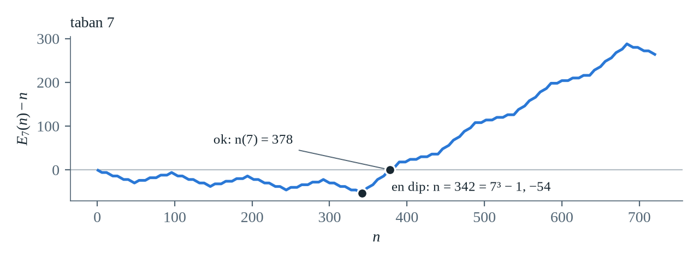
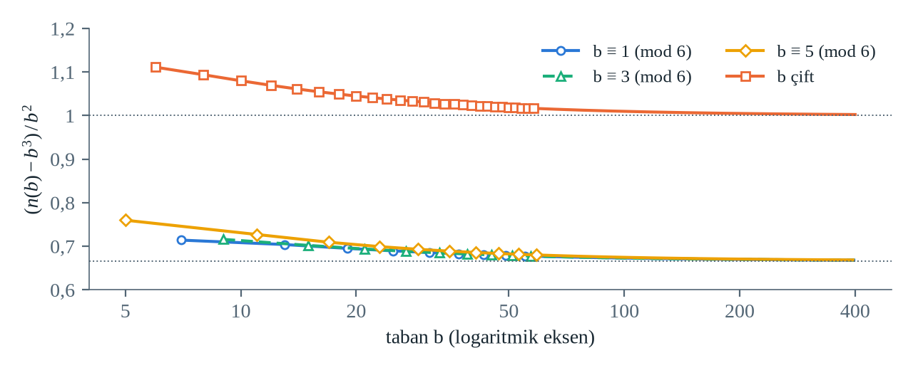
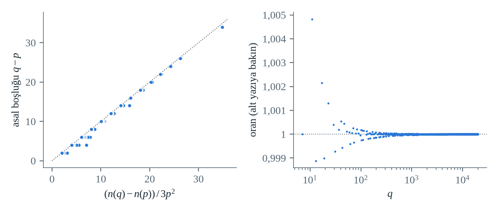
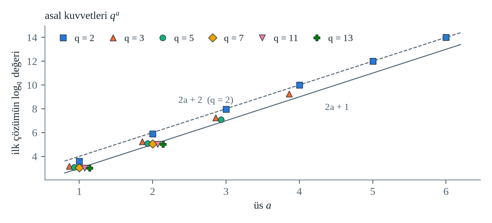

# FactorX

James Augustus · ORCID [0009-0002-7286-7730](https://orcid.org/0009-0002-7286-7730)

Sayıların evren dili ve asıl örneği: Bow Draw

Sürüm 1.0, 23 Kasım 2026

## Öz

FactorX, sayıları üç durumla anlatan bir dildir: hiçlik (0), varlık (1) ve düallik (iki varlığın yan yana gelmesi, `11`). Bir tabanın yazı dünyasına evren denir. Bir hane tabandan büyük bir sayıyı da tutabilir. Bu dilde her n ≥ 2 sayısı, tabanı n − 1 olan evrenin ilk çiftidir: n = `[1][1]_(n−1)`. n'nin göründüğü evren sayısı τ(n) − 1'dir. Burada τ(n), n'nin bölen sayısıdır. Asal sayı, yalnız tek bir evrende, kendi ilk çifti olarak görünen sayıdır. Bu yüzden dilde tek bir asal biçim vardır: `[1][1]`. Aynı dilde iki klasik olgu daha yazılır (Bölüm 3.3, 3.4 ve 3.6). Sıradan hanelerle iki sayı toplanırken her elde 0 ya da 1'dir. Bileşik bir d için Pascal üçgeninin d − 1. satırı, d'ye göre okununca, C(d − 1, j) ≡ (−1)^j kalıbından ilk kez r = b + 1 sütununda ayrılır. Burada b, d'nin kopya olarak göründüğü en küçük evrendir. Asal d'de satır bu kalıptan hiç ayrılmaz.

Asıl örnek Bow Draw'dır. b evreninde Pascal üçgeninin her k ≥ 1 satırı için ⌊k/2⌋ ile ⌈k/2⌉ yarıları toplanır ve eldeler sayılır. E_b(n), 1'den n'ye kadar satırlardaki eldelerin toplamıdır. b bir p asalı olduğunda Kummer'in teoremine göre E_p(n), c(k) = C(k, ⌊k/2⌋) merkez binom katsayılarının c(1)·c(2)···c(n) çarpımında p'nin üssüdür. E_b(n) − n farkı önce iner, b³ civarında en dibe varır, sonra yükselir ve sıfırı keser (b ≥ 4 çift tabanlarda bu biçim ölçülmüştür, kanıtlanmamıştır). Kesişme noktasına Bow Draw noktası diyorum ve onu n(b) ile gösteriyorum. Bu nokta yalnız b'nin 6'ya göre kalanına bağlı bir formülle tam olarak verilir. Örneğin her çift b için n(b) = b³ + b² + b − 2'dir ve n(7) = 378'dir.

Her b ≥ 2 tabanı için E_b(n(b)) = n(b) olduğunu polinom sertifikalarına dayanan bilgisayar destekli bir kanıtla gösteriyorum. Her tek taban ve b = 2 için ayrıca n(b)'nin bir çözüm olduğunu, tek çözüm olduğunu ve E_b(n) − n'nin işaretini yalnız orada değiştirdiğini elle kanıtlıyorum. Böylece her asal taban için sonuç bilgisayar gerektirmez. b ≥ 4 çift tabanlarda teklik kanıtlanmamış, ölçülmüştür: b < 2000 olan her tabanda 3b³ + 300'e kadar her n'yi saydım.

Programların sınaması olarak yer formülünü ayrıca tam sayı aritmetiğiyle 5 ≤ p < 10¹⁰ olan bütün asallarda (2 ve 3 tabanlarını doğrudan saydım), 20 ile 200 basamak arasındaki 12 000 rastgele asalda ve 3 ≤ e ≤ 136 279 841 aralığındaki bilinen 2^e − 1 Mersenne asallarında denetledim. Bunlar 22 Kasım 2026'da bilinen 52 Mersenne asalından (GIMPS listesi [7]) en küçüğü olan 2² − 1 = 3 dışındaki 51 tanesidir. Bileşik bir m için c(1)···c(n) çarpımında m'nin üssü başka bir büyüklüktür. Karesiz m için K_m(n) = n denkleminin (Bölüm 6.7) yalnız bir çözümü vardır ve çözüm en büyük asal çarpanın noktasıdır.

Bow Draw yasası her evrende aynı biçimde geçerlidir ve asallığı kullanmaz. Bu yüzden ne Bow Draw ne de dilin teoremleri bir asallık testi veya çarpanlara ayırma yöntemidir. Dilin teoremleri klasik olguları yeniden yazar. Dil yalnız onları tek bir biçimle ve üç durumla yazmanın bir yolunu önerir.

## 1. Amaç ve kapsam

FactorX'in amacı, bölünebilirliği ve asal üsleri konumlu yazımın kendi diliyle anlatmaktır. Bir sayının asal mı bileşik mi olduğu, hangi evrenlerde ve hangi biçimde göründüğüyle söylenir. Bölüm 2 dili, Bölüm 3 dilin üç teoremini verir.

Bow Draw bu dilin asıl örneğidir ve metnin büyük kısmını oluşturur (Bölüm 4 ile 9). Soru kısaca şudur. Eldeler satır satır sayılır. Kaç satırdan sonra toplam elde sayısı satır sayısına eşit olur? Bu soruyu her b ≥ 2 tabanı için yanıtlıyorum; tekliği tek b ve b = 2 için kanıtlıyorum. Tanımları, yer formülünü, kanıtları, küçük ve büyük işlenmiş örnekleri ve her sayıyı yeniden üreten programları veriyorum. Ayrıca farklı tabanların kesişme noktalarının birbirine göre nerede durduğunu anlatıyorum.

Burada bir asallık testi, çarpanlara ayırma yöntemi veya donanım tasarımı anlatmıyorum. Bir ifade yalnız sonlu bir aralıktaki sayıma dayanıyorsa bunu aralığıyla birlikte söylüyorum. Ek A'da bu sonuçlara götüren sezgilerimi ve çalışmanın çıkış noktasını kendi sözlerimle veriyorum.

## 2. Evren dili

**İki sözcük, iki anlam.** Bu metinde "çift" ve "asal" benim dilimde de geçer.

**Çift (düallik).** İki varlığın yan yana gelmesi, `11`. Her evrende sayma 0'dan başlar, `10`'dan sonra `11`'e varır. O `11` evrenin ilk çiftidir: `[1][1]_b` = b + 1. Bir sayı bir evrende çiftse o evrenin ilk çiftidir ya da onun kopyasıdır, yani katıdır. Sıradan çiftlik bunun bir hâlidir: 2'nin evrenindeki (b = 1) çiftlik. 2 = `[1][1]_1`, sayma sistemimizin ilk `11`'i, en küçük çifttir.

**Asal.** Asalları genelde deneyerek, tek tek buluruz. Bu dilde hepsi aynı yerde durur: bir evrenin `11`'i. Benim sezgimde her evrenin asalı o evrenin `11`'idir. Sıradan anlamda asal ise `11` olarak yalnız kendi evreninde görünen sayıdır (Teorem 1). Örneğin 4 = `[1][1]_3`, 3'ün evreninin `11`'idir. Ama `[2][2]_1` olarak 2'nin evreninde de göründüğü için sıradan anlamda asal değildir. 2 ise sıradan anlamda da asaldır: yalnız kendi evreninde görünür.

| sözcük | anlamı | örnek |
|---|---|---|
| hiçlik | 0 | |
| varlık | 1 | |
| düallik | iki varlığın yan yana gelmesi, `11` | 2 = `[1][1]_1` |
| evren b | b tabanındaki yazım, b ≥ 1 | 13'ün evreni b = 12 |
| hane | bir tabanın tek basamağı. Geniş olabilir: her x ≥ 0 değerini tutar. `[x][y]_b` = x·b + y | `[3][3]_2` = 9 |
| ilk çift | `[1][1]_b` = b + 1 | 13 = `[1][1]_12` |
| kopya | `[a][a]_b` = a·(b + 1), a ≥ 2 | 12 = `[2][2]_5` |
| r'nin evreni | r'nin ilk çift olduğu evren, b = r − 1 | 17'nin evreni b = 16 |
| çift (bir evrende) | n, r'nin evreninde çifttir: n, r'nin ilk çifti ya da onun kopyasıdır, yani r'nin katıdır | 3587, 17'nin evreninde çifttir |
| τ(n) | n'nin bölen sayısı, 1 ve n dahil | τ(12) = 6 |

Geniş hane yazımı tek değildir. Aynı sayı bir tabanda birden çok biçimde yazılabilir. Burada yalnız iki haneli `[a][a]_b` biçimini kullanıyorum. b = 1 evreni de kabul edilir: `[a][a]_1` = 2a.

İfadelerin durumu şu etiketlerle yazılır.

| Etiket | Anlamı |
|---|---|
| GEÇERLİ (kanıt) | Bu notta yazılı bir kanıtla gösterilmiştir |
| GEÇERLİ (bilgisayar destekli kanıt) | Bu notta kanıtlanmıştır. Bir adım, tam aritmetikle programla denetlenen sonlu sayıda polinom eşitsizliğidir |
| ÖLÇÜLDÜ | Yalnız belirtilen aralıkta programla sayılmıştır. Kanıt yoktur |
| SINANMADI | Ne kanıtlanmış ne sayılmıştır |

Programlar sonucu PASS (geçti) veya FAIL (kaldı) olarak yazar.

## 3. Dilin üç teoremi

### 3.1 Her sayı bir ilk çifttir

**Teorem 1** (GEÇERLİ, kanıt). n ≥ 2 olsun. a ≥ 1 ve b ≥ 1 için n = `[a][a]_b` eşitliği, ancak ve ancak b + 1 sayısı n'yi böldüğünde ve a = n/(b + 1) olduğunda sağlanır. Bu nedenle:

1. Her n, b = n − 1 evreninde ilk çifttir: n = `[1][1]_(n−1)`.
2. n'nin göründüğü evren sayısı τ(n) − 1'dir.
3. n, ancak ve ancak asalsa tek bir evrende görünür.

*Kanıt.* `[a][a]_b` = a·b + a = a·(b + 1). Bu yüzden n = `[a][a]_b` olması, a·(b + 1) = n olması demektir. n'nin 2 ≤ d ≤ n olan her d böleni tam bir evren verir: b = d − 1 ve a = n/d. Bu bölenlerin sayısı, 1 dışarıda bırakıldığı için τ(n) − 1'dir. d = n böleni birinci maddeyi verir. Son olarak τ(n) − 1 = 1 eşitliği τ(n) = 2 demektir. Bu da n'nin asal olmasıdır. ∎

### 3.2 Tek asal biçim

Teorem 1'e göre bütün asallar aynı biçimdedir: kendi evrenlerinde `[1][1]` olarak görünürler ve başka hiçbir evrende görünmezler. Bileşik bir sayı bu biçimin yanında en az bir evrende kopya olarak da görünür. Bu dilde tek bir asal biçim vardır, `[1][1]`. Sıradan anlamdaki asallar, yalnız bu biçimde görünen sayılardır.

İlk çift sayı 2'dir ve 2 = `[1][1]_1`. Her çift n sayısı n = `[n/2][n/2]_1` olarak yazılır: 2'nin evreninde ilk çifttir (n = 2) ya da onun kopyasıdır (n ≥ 4). Sıradan anlamdaki çiftlik, 2'nin evrenindeki çiftliktir. Aynı biçimde 3'ün katları 3'ün evreninde (b = 2) çifttir: 9 = `[3][3]_2`.

**Geniş hane neden gereklidir.** Haneler sıradan biçimde, tabandan küçük tutulursa (a < b) Teorem 1'in üçüncü maddesi bozulur. Sıradan hanelerle hiçbir evrende kopya olarak yazılamayan bileşik sayılar tam olarak 6 ve asal karelerdir (GEÇERLİ, kanıt; 4 ile 200 000 arasında 87 sayı). Kanıt Schott'un yolunu izler [9, s. 32, 36]. n bileşik, p en küçük asal böleni ve m = n/p ≥ p olsun. m ≥ p + 2 ise n = `[p][p]_(m−1)`'dir ve p ≤ m − 2 sıradan bir hanedir. m = p ise n = p²'dir ve a(b + 1) = p² eşitliğinin 2 ≤ a < b ile çözümü yoktur. m = p + 1 ise m'nin her asal böleni en az p'dir ve m < 2p ≤ p² olduğundan m asaldır; p ile p + 1 ikisi birden yalnız p = 2'de asaldır, yani n = 6'dır ve 6'nın da böyle bir biçimi yoktur. Örneğin 9 = 3·3 sıradan hanelerle hiçbir tabanda kopya olarak, yani a ≥ 2 ile `aa` biçiminde yazılamaz. Geniş haneyle 9 = `[3][3]_2`'dir. Sıradan hanelerle ve hanenin istenen sayıda tekrar edildiği yazımla bu soru Brezilya sayıları adıyla bilinir [9] (OEIS A125134 [3]).

### 3.3 Toplama 0, 1 ve 2'nin dışına çıkmaz

**Teorem 2** (GEÇERLİ, kanıt). Sıradan hanelerle (her hane 0 ile b − 1 arasında) yazılmış iki sayı b ≥ 2 tabanında toplanırken her hanedeki elde 0 ya da 1'dir. Geniş hanelerle bu tutmaz: 2 tabanında `[3][3]` + `[3][3]` son hanede 6 ve 3 elde verir.

*Kanıt.* İlk haneye gelen elde 0'dır. Bir haneye gelen elde en çok 1 ise o hanede toplanan değer en çok (b − 1) + (b − 1) + 1 = 2b − 1 olur. 2b − 1 < 2b olduğundan sonraki haneye geçen elde ⌊(2b − 1)/b⌋ = 1'i aşmaz. Tümevarımla her elde 0 ya da 1'dir. ∎

Bu dilde her hanede taşma (elde) ya yoktur (hiçlik) ya da tek bir varlıktır. Dolu bir haneye eklenen ve sığmayan kısım, tek bir varlık olarak sonraki haneye geçer. 2 ile 999 arasındaki tabanlarda, 10³⁰'dan küçük sayılarla yapılan 200 000 rastgele toplamada en büyük elde 1'dir (ÖLÇÜLDÜ).

### 3.4 Pascal satırı sayının göründüğü ilk evreni gösterir

d ≥ 2 olsun. d'nin göründüğü en küçük evren b olsun ve r = b + 1 denilsin. Teorem 1'e göre r, d'nin 1'den büyük en küçük bölenidir. Bu yüzden r, d'nin en küçük asal bölenidir. d asalsa r = d'dir.

**Teorem 3** (GEÇERLİ, kanıt). Pascal üçgeninin d − 1. satırında her j < r için C(d − 1, j) ≡ (−1)^j (mod d) olur. d bileşikse bu eşitlik ilk kez j = r sütununda bozulur. Sonraki sütunlar da bozulabilir (d = 4: j = 2 ve 3). d asalsa satır hiç bozulmaz.

*Kanıt.* C(d − 1, j), (d − i)/i çarpanlarının i = 1'den j'ye kadar çarpımıdır. i, d ile aralarında asalsa mod d'de (d − i)·i⁻¹ ≡ −1 olur. i < r olan her i, d ile aralarında asaldır. Bu yüzden j < r için C(d − 1, j) ≡ (−1)^j'dir. d asalsa r = d'dir ve satırın bütün sütunları j ≤ d − 1 < r koşulunu sağlar.

d bileşik olsun ve eşitlik j = r'de de sağlansın. O zaman C(d, r) = C(d − 1, r) + C(d − 1, r − 1) ≡ (−1)^r + (−1)^(r−1) = 0 (mod d) olur. Öte yandan C(d, r) = (d/r)·C(d − 1, r − 1)'dir. C(d − 1, r − 1) ≡ ±1 (mod d) olduğundan r bu sayıyı bölmez. Bu yüzden C(d, r) içinde r'nin üssü, d'deki üssünden bir eksiktir ve d, C(d, r)'yi bölemez. Bu bir çelişkidir. ∎

Bu dilde: d − 1. satır 1, −1, 1, −1, … diye gider ve ilk kez r sütununda bozulur. Burada r, d'nin bir kopya olarak göründüğü en küçük evrenin (b = r − 1) ilk çiftidir, yani d'nin çift olduğu ilk evrenin ilk çifti. Asal sayı yalnız kendi evreninde göründüğü için satırı hiç bozulmaz.

### 3.5 Bow Draw bu dilde

b evreninde her k ≥ 1 satırı için k'nin iki yarısı, ⌊k/2⌋ ve ⌈k/2⌉, toplanır ve taşmalar sayılır. Teorem 2'ye göre her taşma tek bir varlıktır. E_b(n), 1'den n'ye kadar satırlardaki taşmaların toplamıdır. Bölüm 4 ile 7 bunu ayrıntısıyla işler. Sonuçlar şunlardır:

1. E_b(n) = n eşitliğini sağlayan n(b) her b ≥ 2 için vardır (Teorem 4, GEÇERLİ, bilgisayar destekli kanıt).
2. Bu çözüm her tek b ve b = 2 için tektir (Teorem 5, GEÇERLİ, kanıt). Çift b ≥ 4 için teklik b < 2000 olan her tabanda sayıldı (ÖLÇÜLDÜ).
3. n(b), yalnız b'nin 6'ya göre kalanına bağlı bir polinomdur.

| evren b | 7 | 9 | 10 |
|---|---|---|---|
| b'nin türü | asal | bileşik, tek | bileşik, çift |
| n(b) | 378 | 787 | 1108 |

Yasa, b'nin asal olup olmadığına bakmaz. Asal, bileşik, tek ve çift evrenlerde aynı biçimdedir. b bir p asalı olduğunda E_p(n), c(1)·c(2)···c(n) çarpımında p'nin üssüdür (Kummer [1]). Asallık ancak bir sayının kaç evrende göründüğüne bakılınca ortaya çıkar (Teorem 1). Bu yüzden Bow Draw bir asallık testi değildir.

### 3.6 İlgili çalışmalar

Bu bölümdeki sonuçların içeriği klasiktir. Onları evren diliyle yazıyorum, ama burada yeni bir teorem ileri sürmüyorum. 22 Kasım 2026'da OEIS, zbMATH Open, arXiv, Crossref ve genel bir web arama motorunda arama yaptım; Dickson'ın History kitabının IX. bölümüne [15] ve aşağıda andığım çalışmalara baktım.

Her n ≥ 3 sayısının n − 1 tabanında `11` olması bilinir: Brezilya sayılarının tanımının b < n − 1 istemesinin gerekçesi budur (Schott [9, s. 30]; OEIS A125134 ve A167782'deki yorumlar [3]). Sıradan hanelerle iki haneli `aa` biçiminin a hanesi n'nin bir bölenidir [9, §II.1]. A220136, 1 < b < n − 1 için bütün tekrar-hane biçimlerini sayar. A326387'deki bir yorum, ne kare ne de ardışık iki sayının çarpımı olan bileşik n için τ(n)/2 − 1 iki haneli biçim verir [3]. Geniş haneyle sayı τ(n) − 1, yani öz bölen sayısı olur (A032741 [3]). Teorem 1'in 3. maddesi, asalı yalnız birimle ölçülen sayı diye tanımlayan Öklid tanımının yeniden yazılışıdır [16, Tanım 11]. Bölüm 3.2'deki sayım (6 ve asal kareler) Schott'un Teorem 1'inin kanıtından ve Lemma 1'inden çıkar [9, s. 32, 36]. 0, …, b − 1 dışındaki haneler ve bunların getirdiği tek olmayan yazılışlar konumsal gösterimde bilinir (Knuth [22, §4.1]). "Geniş hane" adını baktığım kaynaklarda bulamadım.

Teorem 2 bilinen bir olgudur: sıradan hanelerle iki sayı toplanırken her elde 0 ya da 1'dir. Kummer'in elde denklemlerinde Dickson'ın aktardığı biçimiyle [15, s. 270] ve Diaconis ile Fulman'ın çalışmasında [21] yer alır.

Teorem 3, Pascal kuralıyla, n ∤ C(n, k) olan en küçük k'nin n'nin en küçük asal böleni olduğu bilinen ifadeye denktir (OEIS A020639'daki bir yorum [3]). Ana adım, yani q asal ve q^k ‖ n iken q^k'nin C(n, q)'yu bölmemesi, [17]'deki Lemma 2.1'in kanıtındadır. Sondow aynı türden bir en küçük asal bölen testini C(m + ℓ, ℓ) mod m için kanıtlamıştır [18]. Bileşik d için r ≤ √d olduğundan Teorem 3 aşağıdaki √d sınırını da verir; Babbage testi için aynı çıkarım [18]'de 1. sonuç olarak yer alır. C(n, 1), …, C(n, n − 1) sayılarının en büyük ortak böleni yalnız n bir asal kuvveti olduğunda 1'den büyüktür (Ram, [15, s. 274]'teki aktarımıyla).

Asal d için satır 1, −1, 1, … diye gider (Lucas [8]). Tersi Deutsch ve Gessel'in 1494 numaralı problemidir [10] ve karar vermek için yaklaşık √d sütun yeter (Cai [11]). Bu üç sonucu özgün makalelerden değil, Meštrović'in [12] aktarımından biliyorum. [11] makalesi T. X. Cai ve A. Granville adlarıyla basılmıştır; aynı derginin bir düzeltme notu A. Granville'in yazar olmadığını bildirir [13].

Teorem 3'ün d − 1. satır için yazılmış hâlini bu kaynaklarda bulamadım, ama onlara bakarak bunu bilinen olguların yeniden yazılışı sayıyorum. Dilin kattığı, bu sonuçları tek biçimle (`[1][1]`) ve üç durumla yazmanın bir yoludur. Daha önceki bir kaynak bildirilirse sonraki sürümde eklerim.

Bow Draw ile ilgili çalışmalar Bölüm 6.6'dadır.

### 3.7 Küçük örnekler

| n | evren sayısı | yazılışlar | sonuç |
|---|---|---|---|
| 7 | 1 | `[1][1]_6` | asal |
| 9 | 2 | `[1][1]_8`, `[3][3]_2` | 3'ün evreninde çift |
| 12 | 5 | `[1][1]_11`, `[2][2]_5`, `[3][3]_3`, `[4][4]_2`, `[6][6]_1` | τ(12) − 1 = 5 |
| 17 | 1 | `[1][1]_16` | asal |

### 3.8 Sınır durumları

n = 2 yalnız b = 1 evreninde görünür: 2 = `[1][1]_1`. 2 asaldır ve ilk çifttir (ilk `11`). n = 4 iki evrende görünür: `[1][1]_3` ve `[2][2]_1`. 4 = 2·2 en küçük asal karedir.

### 3.9 Sıradan hanelerle yazılamayan durum

6 = 2·3, sıradan hanelerle hiçbir evrende kopya değildir. `[2][2]_2` yazımında 2 hanesi tabana eşittir. `[3][3]_1` yazımında 3 hanesi tabandan büyüktür. Geniş haneyle ikisi de geçerlidir ve 6 üç evrende görünür (τ(6) − 1 = 3). Bölüm 3.2'deki ölçüme göre sıradan hanelerde bu durum yalnız 6'da ve asal karelerde ortaya çıkar.

### 3.10 Büyük örnekler

2⁶¹ − 1 = 2 305 843 009 213 693 951 asaldır (Pervushin, 1883 [7]). Bu yüzden yalnız bir evrende görünür: `[1][1]_2305843009213693950`.

2⁶⁷ − 1 = 147 573 952 589 676 412 927 = 193 707 721 · 761 838 257 287 (Cole, 1903 [23]) ve iki çarpan da asaldır. τ = 4 olduğundan sayı üç evrende görünür:

```text
[1][1]_147573952589676412926
[193707721][193707721]_761838257286
[761838257287][761838257287]_193707720
```

Pascal satırı için 3587 = 17 · 211 alınsın. 3586. satır mod 3587'de 16. sütuna kadar 1, −1, 1, … diye gider ve 17. sütunda bozulur. d = 1 022 117 = 1009 · 1013 için 1 022 116. satır 1009. sütunda bozulur.

## 4. Bow Draw: tanımlar ve gösterimler

Bu bölümden Bölüm 7'nin sonuna kadar haneler sıradan hanelerdir: b tabanında her hane 0 ile b − 1 arasındadır.


### 4.1 Taban, haneler ve elde

Taban b ≥ 2 bir tam sayıdır. Her x ≥ 0 tam sayısının b tabanında 0 ile b − 1 arasında haneleri vardır. x ile y hane hane toplanırken bir konumdaki hane toplamı, gelen eldeyle birlikte b'ye ulaşırsa o konumda elde oluşur. Elde sayısı carries_b(x, y) ile gösterilir.

Bir i konumuna gelen elde ⌊(x + y)/b^i⌋ − ⌊x/b^i⌋ − ⌊y/b^i⌋'dir. Buradan şu eşitlik çıkar:

```text
carries_b(x, y) = Σ_{i ≥ 1} ( ⌊(x + y)/b^i⌋ − ⌊x/b^i⌋ − ⌊y/b^i⌋ )    (4.1)
                = ( s_b(x) + s_b(y) − s_b(x + y) ) / (b − 1)    (4.2)
```

Burada s_b(x), x'in b tabanındaki hanelerinin toplamıdır. İki biçim de asal veya bileşik her tabanda geçerlidir.

### 4.2 Satırlar, merkez katsayılar ve elde toplamı

Pascal satırları k = 0'dan başlayarak numaralanır. k satırında k + 1 eleman vardır. k satırının merkez katsayısı satırın en büyük elemanıdır (OEIS A001405 [3]):

```text
c(k) = C(k, ⌊k/2⌋)

k      1   2   3   4    5    6    7    8     9    10
c(k)   1   2   3   6   10   20   35   70   126   252
```

k ≥ 1 için k satırının b tabanındaki elde sayısı

```text
κ_b(k) = carries_b(⌊k/2⌋, ⌈k/2⌉)
```

ve n satırına kadarki elde toplamı

```text
E_b(n) = κ_b(1) + κ_b(2) + ... + κ_b(n)
E_b(0) = 0
D_b(n) = E_b(n) − n
```

olarak tanımlanır. D_b(n), birikmiş eldelerle satır sayısı arasındaki farktır.

### 4.3 Kummer'in teoremi

p asal ve N ≥ 1 bir tam sayı olmak üzere v_p(N), N'de p'nin üssünü, yani p^e'nin N'yi böldüğü en büyük e'yi gösterir. v_p(C(x + y, x)) üssü carries_p(x, y)'dir [1] (ayrıca Granville'in derlemesine bakın [19]). Bu yüzden κ_p(k), c(k)'da p'nin üssüdür ve E_p(n), c(1)·c(2)···c(n) çarpımında p'nin üssüdür.

p = 3 ve k = 10 örneği. İki yarı 5 ve 5'tir. 3 tabanında 5 = 12 yazılır.

```text
      1 2
    + 1 2
    -----
    2 + 2 = 4 ≥ 3            elde 1
    1 + 1 + 1 = 3 ≥ 3        elde 2
```

İki elde vardır. Gerçekten c(10) = 252 = 4 · 9 · 7'dir ve 3'ün üssü 2'dir.

Bileşik bir b tabanında E_b(n) yine iyi tanımlı bir elde sayısıdır, fakat çarpımda b'nin üssü değildir. Bileşik bir m'nin üssü başka bir fonksiyondur ve Bölüm 6.7'de K_m(n) olarak ele alınır.

### 4.4 Bow Draw noktası

(6.1) formülünün verdiği n(b) sayısına b'nin Bow Draw noktası diyorum. Teorem 4, her b ≥ 2 için E_b(n(b)) = n(b) olduğunu gösterir. Tek b ve b = 2 için başka çözüm yoktur (Teorem 5). Çift b ≥ 4 için sayılan aralıkta başka çözüm bulunmadı (Bölüm 6.1). Ad, D_b'nin biçimini anlatır. Fark önce, gerilen bir yay gibi aşağı iner. En dibe b³ civarında varır. Sonra yükselir ve sıfırı n(b)'de keser. Okun düştüğü yer burasıdır.

## 5. Bow Draw: yöntem

### 5.1 Doğrudan sayım

İlk yöntem tanımı izler. Program 1'den bir N sınırına kadar her n için n'nin iki yarısını b tabanında hane hane toplar ve eldeleri bir toplama ekler. D_b(n)'nin her sıfırını, ilk sıfırdan önceki ve sonraki işaretini ve en küçük değerinin yerini ve değerini kaydeder. Her yerde kullanılan sınır N = 3b³ + 300'dür. Bu, beklenen kesişme noktasının yaklaşık üç katıdır. Bu yöntem hiçbir formül kullanmaz. `tests/check_small.py` ve `tests/c/bow_draw_scan.c` içinde uygulanmıştır.

### 5.2 Kapalı biçim

İkinci yöntem, E_b(n)'yi önceki satırları gezmeden tek bir n için hesaplar. b tabanı için şunlar tanımlanır:

```text
f(m)     = Σ_{i ≥ 1} ⌊m / b^i⌋
g(n, q)  = Σ_{k=1..n} ⌊k / q⌋ = q · a(a − 1)/2 + a(r + 1)
           burada n = a·q + r, 0 ≤ r < q
S(n)     = f(1) + f(2) + ... + f(n) = Σ_{i ≥ 1} g(n, b^i)
```

(4.1)'den κ_b(k) = f(k) − f(⌊k/2⌋) − f(⌈k/2⌉) olur. k üzerinden toplanınca

```text
E_b(n)  = S(n) − T(n)
T(2m)   = 4·S(m) − f(m)
T(2m+1) = T(2m) + f(m) + f(m + 1)    (5.1)
```

elde edilir. T(n), k = 1'den n'ye f(⌊k/2⌋) + f(⌈k/2⌉) toplamıdır. n = 2m için k = 2j çift satırları j = 1'den m'ye 2f(j) katar. k = 2j + 1 tek satırları j = 0'dan m − 1'e f(j) + f(j + 1) katar. Toplam 2S(m) + (S(m) − f(m)) + S(m) = 4S(m) − f(m)'dir. Tek durum 2m + 1 satırını ekler.

g formülü ⌊k/q⌋ = j olan k'leri sayar. 1 ≤ j < a için bunlardan q tane, j = a için r + 1 tane vardır. E_b(n)'nin her değeri, n büyüklüğündeki tam sayılarla O(log_b n) işlemle hesaplanır. p asalı için f(m), m!'de p'nin üssüdür (Legendre formülü [2]).

b = 7 ve n = 378, yani m = 189 örneği: S(378) = 11 388, S(189) = 2760, f(189) = 30, T(378) = 4 · 2760 − 30 = 11 010 ve E_7(378) = 11 388 − 11 010 = 378.

### 5.3 Ekran kartında blok taraması

Üçüncü yöntem, doğrudan sayımı bağımsız bir uygulama olarak Vulkan hesap gölgelendiricileriyle ekran kartında yineler. Kart ⌊n/2⌋ ve ⌈n/2⌉ değerlerini b tabanında hane dizileri olarak tutar. n'den n + 1'e geçerken iki yarıdan yalnız biri bir artar. Bu yüzden bölme gerekmez. Kart aralığı 256 ardışık n'lik bloklara böler. Her blok için κ_b(n) − 1 toplamını ve blok içindeki en küçük ve en büyük kısmi toplamı döndürür. İşlemci blokları sırayla toplar ve böylece D_b'yi her blok sınırında bilir. Sonra sıfırın düşebileceği her bloğu ve en küçük değeri içeren bloğu işlemcide yeniden sayar. Program `tests/gpu/bow_draw_gpu.c`, gölgelendirici `tests/gpu/bow_draw_block64.comp` dosyasındadır. 64 bit tam sayılar kullanılır.

### 5.4 Polinom sertifikaları

Dördüncü yöntem varlığı kanıtlar. r, 0 ile 11 arasında olmak üzere b = 12t + r yazılır. On iki sınıfın her birinde (6.1)'deki n(b), t'nin rasyonel katsayılı bir polinomudur. (5.1) kapalı biçimindeki her ⌊x(t)/q(t)⌋ tam kısmında pay x(t) bir polinomdur, payda q(t) ise b, b² veya b³'tür. Program her tam kısım için interpolasyonla aday bir F(t) polinomu bulur. Sonra her t ≥ t₀ için 0 ≤ x(t) − q(t)F(t) ≤ q(t) − 1 olduğunu gösterir. Bunun için t yerine t + t₀ konur ve iki polinomun bütün katsayılarının negatif olmadığı denetlenir. Her tam kısım sertifikalı polinomuyla değiştirilince E_b(n(b)) − n(b), t'nin bir polinomu olur. Program bunun sıfır polinom olduğunu denetler. t₀'ın altındaki tabanlar doğrudan denetlenir. Bütün aritmetik tamdır. Sertifikayı üç olgu kanıt yapar. Birincisi, F(t) altı ardışık tam sayıda tam sayı değerlerinden geçer ve derecesi en çok 5'tir; bu yüzden bütün ileri farkları tam sayıdır ve F(t) her tam sayı t için bir tam sayıdır. İkincisi, x(t) sınıfın her b'si için bir tam sayıdır: n(b), t'nin tam sayı değerli bir kübik polinomudur ve paritesi sınıf içinde sabittir (tam sayı değerli bir kübiğin paritesi 4'ü bölen bir dönemle tekrar eder; program 60 ardışık değeri denetler). F ve x tam sayı değerli olunca 0 ≤ x − qF ≤ q − 1 tam olarak F = ⌊x/q⌋ demektir. Üçüncüsü, program b³ ≤ n(b) < b⁴ ve m + 1 < b³ eşitsizliklerini de sertifikalar; böylece kapalı biçimin terim sayısı bütün sınıfta sabittir (Bölüm 6.3). Program `tests/check_certificates.py` dosyasındadır.

## 6. Bow Draw: matematiksel ilişki

### 6.1 Ana sonuçlar

**Teorem 4 (varlık).** Her b ≥ 2 tam sayısı için E_b(n(b)) = n(b)'dir. Burada

```text
b çift:              n(b) = b³ + b² + b − 2
b ≡ 1 (mod 6):       n(b) = b³ + (2b² + 2b − 7) / 3
b ≡ 3 (mod 6):       n(b) = b³ + (2b² + 2b − 6) / 3
b ≡ 5 (mod 6):       n(b) = b³ + (4b² + 5b − 11) / 6    (6.1)
```

**Teorem 5 (teklik ve işaret).** b tek veya b = 2 olsun. O zaman E_b(n) = n eşitliğini sağlayan tek n ≥ 1 sayısı n(b)'dir. Ayrıca 1 ≤ n < n(b) için D_b(n) < 0 ve n > n(b) için D_b(n) > 0'dır.

**Teorem 6 (derinlik).** Tek b için D_b(n)'nin bütün n ≥ 1 üzerindeki en küçük değeri −(b − 1)(b + 2)'dir. Bu değer n = b³ − 1'de alınır.

| İfade | Durum |
|---|---|
| Teorem 4, her b ≥ 2 | GEÇERLİ (bilgisayar destekli kanıt), Bölüm 6.3 |
| Teorem 4, tek b ve b = 2 | GEÇERLİ (kanıt), Bölüm 6.4 ve 6.5 |
| Teorem 5, tek b ve b = 2 | GEÇERLİ (kanıt), Bölüm 6.4 ve 6.5 |
| Teorem 6, tek b | GEÇERLİ (kanıt), Bölüm 6.4 |
| Teorem 7, karesiz m | GEÇERLİ (kanıt), Bölüm 6.7 |
| En uzak asal kuvvet çarpanı kuralı, bileşik m | ÖLÇÜLDÜ: 2 ≤ m ≤ 1000, üç istisna (72, 360, 544) |
| b ≥ 4 çift tabanlarda teklik ve işaret düzeni | ÖLÇÜLDÜ: 4 ≤ b < 2000 olan her çift b'de her n ≤ 3b³ + 300 |
| b ≥ 4 çift tabanlarda en küçük değer −(b² − 2); ilk kez n = b³ − b² − 1'de alınır ve n = b³ − b² + b − 1'e kadar sürer | ÖLÇÜLDÜ: 4 ≤ b < 600 olan her çift b |
| b ≥ 4 çift tabanlarda sayılan aralığın ötesinde teklik | SINANMADI |

p ≥ 5 asalları için (6.1) formülünün tek satırlık bir biçimi vardır. ε = p mod 3 (1 veya 2) ile

```text
n(p) = p³ + (4p² + (3 + ε)·p + 3ε − 17) / 6    (6.2)
```

En küçük iki asal (6.1) kapsamındadır: n(2) = 12 ve n(3) = 33.

```text
b      2    3    4     5     6     7     8     9
n(b)   12   33   82   144   256   378   582   787

b      10     11     12     13     14     15     16
n(b)   1108   1419   1882   2316   2952   3533   4366
```

n(b)'nin paritesi b'nin 12'ye göre kalanına bağlıdır. n(b) tam olarak b ≡ 3, 9 veya 11 (mod 12) olduğunda tektir, diğer durumlarda çifttir. Değer, b'nin 6'ya göre kalanına bağlıdır. Sınıfların doğrusal terimleri farklı olduğu için bütün tek tabanları kapsayan tek bir polinom yoktur.

Kendi b tabanında n(b) ve m = ⌊n(b)/2⌋ sabit hanelerle yazılır, en büyük basamak önce (GEÇERLİ, kanıt):

| Sınıf | b tabanında n(b) | b tabanında m = ⌊n(b)/2⌋ |
|---|---|---|
| b çift | (1, 1, 0, b−2) | (b/2, b/2, b/2−1) |
| b ≡ 1 (mod 6) | (1, 0, (2b+1)/3, (b−7)/3) | ((b−1)/2, (5b+1)/6, (b−7)/6) |
| b ≡ 3 (mod 6) | (1, 0, 2b/3, (2b−6)/3) | ((b−1)/2, (5b−3)/6, (5b−9)/6) |
| b ≡ 5 (mod 12) | (1, 0, (2b+2)/3, (b−11)/6) | ((b−1)/2, (5b−1)/6, (7b−11)/12) |
| b ≡ 11 (mod 12) | (1, 0, (2b+2)/3, (b−11)/6) | ((b−1)/2, (5b−1)/6, (7b−17)/12) |

n(b)'nin her satırı, (6.1)'de n(b) − b³ = c·b + d (0 ≤ c, d < b) yazılarak çıkar; m'nin satırları ikiye bölerek bulunur. b ≡ 5 (mod 12) satırı n(b) için b ≥ 17 ister; b = 5'te n(5) = 144, 5 tabanında (1, 0, 3, 4)'tür. Örneğin n(10) = 1108, 10 tabanında (1, 1, 0, 8)'dir; n(7) = 378 ise 7 tabanında (1, 0, 5, 0)'dır ve m = 189 = (3, 6, 0)'dır. Tek b için m'nin haneleri Bölüm 6.4'teki Adım 6'nınkilerdir: m = (r, r + 1 + k, y). n(b) tam olarak b ≡ 3 (mod 6) ve b ≡ 11 (mod 12) satırlarında tektir. Bunlar, G'nin o adımda sıfırın üstünden atladığı satırların ta kendisidir; yukarıdaki parite kuralını bu açıklar.

### 6.2 Büyüklük

(6.1)'den

```text
b tek:    n(b) = b³ + (2/3)·b² + O(b)
b çift:   n(b) = b³ + b² + O(b)
```

Ok, tabanın küpünün biraz ötesine düşer. Küpün ötesindeki uzaklık b² biriminde ölçülünce tek tabanlarda 2/3'e, çift tabanlarda 1'e yaklaşır.

### 6.3 Teorem 4'ün kanıtı

Yöntem Bölüm 5.4'te anlatılmıştır. Her sınıfta kapalı biçimdeki terim sayısı sabittir. Program b³ ≤ n(b) < b⁴ ve ⌊n(b)/2⌋ + 1 < b³ eşitsizliklerini polinom eşitsizlikleri olarak sertifikalar. Böylece S(n)'nin üç terimi, S(m) ve f(m)'nin iki terimi vardır.

| Sınıf | n(b) | Sertifika | Geçerli | Doğrudan denetlenen |
|---|---|---|---|---|
| b = 12t | çift | 9 | b ≥ 12 | yok |
| b = 12t + 1 | çift | 9 | b ≥ 13 | yok |
| b = 12t + 2 | çift | 9 | b ≥ 14 | b = 2 |
| b = 12t + 3 | tek | 7 | b ≥ 3 | yok |
| b = 12t + 4 | çift | 9 | b ≥ 4 | yok |
| b = 12t + 5 | çift | 9 | b ≥ 17 | b = 5 |
| b = 12t + 6 | çift | 9 | b ≥ 6 | yok |
| b = 12t + 7 | çift | 9 | b ≥ 19 | b = 7 |
| b = 12t + 8 | çift | 9 | b ≥ 8 | yok |
| b = 12t + 9 | tek | 7 | b ≥ 9 | yok |
| b = 12t + 10 | çift | 9 | b ≥ 10 | yok |
| b = 12t + 11 | tek | 7 | b ≥ 11 | yok |

Sertifika sütunu, programın sertifikalı polinomlarla değiştirdiği tam kısım (⌊x/q⌋) sayısıdır. Çift n'de program T = 2S(m − 1) + f(m) + 2S(m) yazar: 3 + 2 + 2 + 2 = 9 tam kısım (S(n) üç, öteki terimler ikişer ister). Tek n'de T = 4S(m) + f(m + 1) yazar: 3 + 2 + 2 = 7 tam kısım. S(m) − S(m − 1) = f(m) olduğundan iki biçim de (5.1) ile aynıdır.

On iki sınıfın hepsinde E_b(n(b)) − n(b) sıfır polinomdur. Sınıflarının sertifikalı aralığının altında kalan 2, 5 ve 7 tabanları doğrudan hesapla E_b(n(b)) = n(b) eşitliğini sağlar. On iki sınıf bütün b ≥ 2 tabanlarını kapsar. ∎

Sertifika yalnız tam kısımları ve b'nin kuvvetlerini kullanır. Asallık kullanmaz. Bu yüzden Teorem 4 bileşik tabanlarda da geçerlidir.

### 6.4 Teorem 4 ile 6'nın tek b için kanıtı

b ≥ 3 tek ve r = (b − 1)/2 olsun. κ(h) = carries_b(h, h), h + h toplamındaki elde sayısıdır. h'nin bir d hanesi, gelen c ∈ {0, 1} eldesiyle birlikte tam olarak 2d + c ≥ b olduğunda elde verir. Bu d > r iken her zaman, d < r iken hiçbir zaman, d = r iken yalnız c = 1 ise olur.

**Lemma 1 (tek satırlar).** Tek b ve h ≥ 0 için carries_b(h, h + 1) = κ(h + 1).

*Kanıt.* t(x), x'in b − 1'e eşit sondaki hanelerinin sayısı olsun. x'e bir eklemek bu haneleri 0 yapar ve sonraki haneyi bir artırır. Bu yüzden s_b(x + 1) = s_b(x) + 1 − (b − 1)·t(x)'tir. (4.2)'den

```text
carries_b(h, h + 1) − carries_b(h + 1, h + 1)
    = ( s_b(h) − s_b(h + 1) − s_b(2h + 1) + s_b(2h + 2) ) / (b − 1)
    = t(h) − t(2h + 1).
```

Geriye t(2h + 1) = t(h) olduğunu göstermek kalır. 2h + 1 hane hane hesaplanır. Eklenen 1, 0. konuma gelen elde olarak alınır. h'nin en alttaki t(h) hanesinin her biri b − 1'dir ve 1 elde alır. Sonuç 2(b − 1) + 1 = 2b − 1'dir. Çıkan hane b − 1 olur ve 1 elde ileri gider. h'nin sonraki d hanesi b − 1 değildir ve o da 1 elde alır. Çıkan hane 2d + 1 veya 2d + 1 − b'dir. İlki tektir, b − 1 ise çifttir, dolayısıyla ilki b − 1 olamaz. İkincisi ancak d = b − 1 ise b − 1'e eşittir ve bu durum dışlanmıştır. O hâlde t(2h + 1) = t(h). ∎

Böylece κ_b(2h) = κ(h) ve κ_b(2h + 1) = κ(h + 1) olur. Lemma 1 çift tabanlarda bozulur (Bölüm 7.3).

**Lemma 2.** G(m) = Σ_{h=1..m} (κ(h) − 1) ve G(0) = 0 olsun. O zaman

```text
E_b(2m) − 2m              = 2·G(m)
E_b(2m + 1) − (2m + 1)    = G(m) + G(m + 1)
```

*Kanıt.* Lemma 1'e göre h = 1'den m'ye 2h çift satırları ve 2h − 1 tek satırları ayrı ayrı κ(h) katar. Bu yüzden E_b(2m) = 2(κ(1) + ... + κ(m)). 2m + 1 satırı κ(m + 1) ekler. ∎

Demek ki D_b'nin işareti G'nin işaretinden çıkar.

**Lemma 3 (blok kuralı).** 0 ≤ x < b^J ve 1 ≤ d ≤ b − 1 olmak üzere h = d·b^J + x olsun. O zaman

```text
d < r :   κ(h) = κ(x)
d = r :   x > (b^J − 1)/2 ise κ(h) = κ(x) + 1,   aksi hâlde κ(h) = κ(x)
d > r :   κ(h) = κ(x) + 1
```

*Kanıt.* Alttaki J hane, h + h ve x + x toplamlarında aynı eldeleri verir. Bunlardan tam olarak 2x ≥ b^J olduğunda dışarı elde çıkar. Üst d hanesi bundan sonra yukarıdaki hane kuralına göre elde verir. d'nin üstündeki bütün haneler 0'dır, bu yüzden d'den çıkan bir elde yeni bir elde doğurmaz. ∎

Kanıt G'yi önce m'nin ilk b³ değeri boyunca, sonra ötesinde izler.

**Adım 0. 1 ≤ m ≤ b² − 1 için G(m) < 0, G((b² − 1)/2) = −r² − 2r ve G(b² − 1) = −r.** Tek haneli h için h > r ise κ(h) = 1, değilse 0'dır. Bu yüzden G, h = 1'den r'ye birer iner, b − 1'e kadar düz kalır ve G(b − 1) = −r olur. x = 0 dahil, b değerlik tam bir blokta κ(x) − 1 toplamı −(r + 1)'dir. İki haneli h = d·b + x için Lemma 3 (J = 1) üç durum verir. d < r blokları bu deseni yineler ve her biri G'yi r + 1 düşürür. d = r bloğunda κ(h) − 1, x ≤ r için −1, x > r için +1'dir. d > r bloklarında κ(h) − 1 = κ(x) ≥ 0'dır ve her biri G'yi r artırır. d = r bloğunun ortasına kadar G hiç yükselmez. Orta nokta h = r·b + r = (b² − 1)/2'dir ve orada

```text
G((b² − 1)/2) = −r − (r − 1)(r + 1) − (r + 1) = −r² − 2r.
```

Sonrasında G hiç inmez ve G(b² − 1) = −r² − r + r·r = −r < 0 değerinde biter. Yani G bütün aralıkta eksidir. 0'dan b² − 1'e bütün x'ler üzerinden κ(x) − 1 toplamı G(b² − 1) − 1 = −(r + 1)'dir.

**Adım 1. 1 ≤ m ≤ (b³ − 1)/2 için G(m) < 0 ve G'nin 1 ≤ m ≤ b³ − 1 üzerindeki en küçük değeri μ = G((b³ − 1)/2) = −2r² − 3r'dir.** Üç haneli h = d·b² + x alınır. B_d = G(d·b² − 1), d bloğundan önceki değer olsun. B_1 = −r'dir ve d < r olan her blok G'yi r + 1 düşürür. Bu yüzden B_d = −r − (d − 1)(r + 1). Böyle bir blokta G(d·b² + x) = B_d − 1 + G(x)'tir. Adım 0'a göre bu değer eksidir ve en az B_{r−1} − 1 − r² − 2r = −2r² − 2r + 1 > μ'dür. d = r bloğunun alt yarısında (x ≤ (b² − 1)/2) Lemma 3 yine κ(h) = κ(x) verir. Bu yüzden G = B_r − 1 + G(x) = −r² − r + G(x) olur ve en küçük değeri x = (b² − 1)/2'dedir. r·b² + (b² − 1)/2 = (b³ − 1)/2 olduğundan

```text
μ = G((b³ − 1)/2) = −r² − r − r² − 2r = −2r² − 3r.
```

Adım 2 ile 4, G'nin b³ − 1'e kadar kalan m'lerde μ'nün üstünde kaldığını gösterir.

**Adım 2. (b³ − 1)/2 ≤ m < (r + 1)·b² − 1 aralığında G her adımda en az 1 artar.** d = r bloğunun üst yarısında x > (b² − 1)/2'dir. Bu yüzden x + x en üst hanesinden dışarı elde verir, κ(x) ≥ 1 olur ve Lemma 3, κ(h) = κ(x) + 1 ≥ 2 verir.

**Adım 3. G((r + 1)·b² − 1) = r² > 0.** d = r bloğu B_r = −r² − r + 1 değerine −(r + 1) + (b² − 1)/2 ekler. (b² − 1)/2 = 2r² + 2r ile toplam r²'dir.

**Adım 4. (r + 1)·b² − 1 ≤ m ≤ b³ − 1 aralığında G hiç inmez ve G(b³ − 1) = r·(b² − 1).** d > r için κ(h) − 1 = κ(x) ≥ 0'dır. r bloğun her biri b² − (r + 1) ekler ve r² + r(b² − r − 1) = r(b² − 1)'dir.

**Adım 5. m ≥ b³ için G(m) ≥ 4r³ + 2r² − 3r − 1 ≥ 2.** b^J ≤ m < b^(J+1) olacak biçimde J ≥ 3 alınır ve y < b^J ile m = d·b^J + y yazılır. Lemma 3'e göre her d' üst hanesi için κ(d'·b^J + x) ≥ κ(x)'tir. Bu yüzden b^J uzunluğundaki her tam blok en az G(b^J − 1) − 1 ekler. Son yarım blok en az G(y) − 1 ekler. Buradan

```text
G(m) ≥ G(b^J − 1) + (d − 1)·(G(b^J − 1) − 1) + G(y) − 1.
```

J üzerinden tümevarım uygulanır. Varsayım, G(b^J − 1) ≥ r(b² − 1) ve 1 ≤ y < b^J için G(y) ≥ μ olmasıdır. J = 3 için bu Adım 1 ile 4'tür. Eşitsizlik bu durumda G(m) ≥ r(b² − 1) + μ − 1 = 4r³ + 2r² − 3r − 1 > μ verir. Bu değer r = 1 için 2'dir ve r ile artar. Ayrıca G(b^(J+1) − 1) ≥ b·G(b^J − 1) − (b − 1) ≥ r(b² − 1) olur. Yani varsayım J + 1 için de geçerlidir. ∎

**Adım 6 (varlık ve yer). D_b'nin bir sıfırı vardır ve bu sıfır (6.1)'deki n(b)'dir.** d = r bloğunun üst yarısında iki haneli kısmı x = (r + 1 + k)·b + y biçiminde yazalım (0 ≤ k ≤ r − 1, 0 ≤ y ≤ 2r). J = 2 ile Lemma 3'ten G(r·b² + x) = B_r − 1 + G(x) + (x − (b² − 1)/2) çıkar. Adım 0'a göre G((r + 1)·b − 1) = −r² − r'dir ve d > r olan her iki haneli blok r ekler. Bu yüzden G(x) = −r² − r + k·r + max(0, y − r)'dir ve

```text
G(r·b² + x) = −2r² − r + 1 + k·(3r + 1) + φ(y),    φ(y) = y + max(0, y − r).
```

x = r·b + y ve y > r için aynı hesap G ≤ −2r² − r < 0 verir. Demek ki G, k·(3r + 1) + φ(y) = 2r² + r − 1 eşitliğini sağlayan k ve y'de işaret değiştirir. Bir blok içinde φ, y ≤ r iken birer, y > r iken ikişer artar; bir bloktan ötekine G bir artar. r = 3s + t ve t ∈ {0, 1, 2} ile:

| r | k | y | D_b'nin sıfırı |
|---|---|---|---|
| 3s (b ≡ 1 mod 6) | 2s | s − 1 | G(m₀) = 0, n = 2m₀ |
| 3s + 1 (b ≡ 3 mod 6) | 2s | 5s + 1 | G(m₁) = −1, G(m₁ + 1) = 1, n = 2m₁ + 1 |
| 3s + 2, s çift (b ≡ 5 mod 12) | 2s + 1 | (7s + 4)/2 | G(m₀) = 0, n = 2m₀ |
| 3s + 2, s tek (b ≡ 11 mod 12) | 2s + 1 | (7s + 3)/2 | G(m₁) = −1, G(m₁ + 1) = 1, n = 2m₁ + 1 |

Burada m = r·b² + (r + 1 + k)·b + y'dir. Her satırda n, (6.1)'e eşittir. Örneğin b = 6s + 1 için 2m₀ = 6s·b² + (10s + 2)·b + 2s − 2 = b³ + (2b² + 2b − 7)/3'tür. İkinci ve dördüncü satırlarda φ gereken değeri 2'lik bir adımla geçer. Bu yüzden G, −1'den 1'e geçer ve Lemma 2'ye göre D_b(2m₁ + 1) = G(m₁) + G(m₁ + 1) = 0 olur. Yani tek b için sıfır vardır ve n(b)'dedir; bilgisayar adımına gerek yoktur. Bu adımın her değerini 3'ten 401'e kadar her tek b için sayısal olarak da denetledim (`tests/check_odd_existence.py`).

**Örnek.** İki tür sıfırı üç taban gösterir.

| b | r, s, t | k, y | m | m çevresinde G (sayıldı) | D_b'nin sıfırı |
|---|---|---|---|---|---|
| 7 | 3, 1, 0 | 2, 0 | m₀ = 3·49 + 6·7 + 0 = 189 | G(188) = −1, G(189) = 0, G(190) = 1 | n = 2·189 = 378 = n(7) |
| 3 | 1, 0, 1 | 0, 1 | m₁ = 1·9 + 2·3 + 1 = 16 | G(16) = −1, G(17) = 1 | n = 2·16 + 1 = 33 = n(3) |
| 11 | 5, 1, 2 | 3, 5 | m₁ = 5·121 + 9·11 + 5 = 709 | G(709) = −1, G(710) = 1 | n = 2·709 + 1 = 1419 = n(11) |

b = 7 için formül G(189) = −2·9 − 3 + 1 + 2·10 + φ(0) = 0 verir. G sıfırı tam vurur ve ok çift bir satıra düşer. b = 3 ve b = 11'de G sıfırın üstünden −1'den 1'e atlar ve ok iki değerin arasındaki tek satıra düşer; orada D_b = G(m₁) + G(m₁ + 1) = 0'dır.

**Sonuç.** G, 1 ≤ m ≤ (b³ − 1)/2 için eksidir. Oradan (r + 1)·b² − 1'deki r² artı değerine kadar kesin artar ve o noktadan sonra hep artıdır. Kesin artan bir dizi sıfır değerini en çok bir kez alır ve işaretini yalnız bir kez değiştirir. G(m₀) = 0 ise n = 2m₀, D_b'nin bir sıfırıdır. Bu durumda D_b(2m₀ − 1) = G(m₀ − 1) < 0 ve D_b(2m₀ + 1) = G(m₀ + 1) > 0'dır. G sıfır olmadan işaret değiştiriyorsa, yani G(m₁) < 0 < G(m₁ + 1) ise, sıfır olabilecek tek yer n = 2m₁ + 1'dir. Öteki her n'de Lemma 2'deki iki terim aynı işaretlidir. Demek ki D_b'nin en çok bir sıfırı vardır, D_b ondan önce eksi, sonra artıdır ve Adım 6'ya göre bu sıfır vardır ve n(b)'dir. Bu, Teorem 4 ile 5'i tek b için bilgisayar adımı olmadan kanıtlar.

Teorem 6 için, D_b(2m) = 2G(m) ve D_b(2m + 1) = G(m) + G(m + 1) değerlerinin ikisi de en az 2μ'dür. Eşitlik, tek b için çift olan 2m = b³ − 1'de sağlanır. Bu yüzden D_b'nin en küçük değeri 2μ = −(4r² + 6r) = −(b − 1)(b + 2)'dir. ∎

### 6.5 Teorem 5'in b = 2 için kanıtı

s(j), j'nin ikili yazımındaki 1'lerin sayısı olsun. (4.2)'ye göre carries_2(j, j) = s(j) ve carries_2(y, y + 1) = s(y + 1) − 1'dir. H(m) = Σ_{j=1..m} (2s(j) − 3) olsun. O zaman

```text
E_2(2m) − 2m              = H(m)
E_2(2m + 1) − (2m + 1)    = H(m) + s(m + 1) − 2
```

İlk değerler H(1), ..., H(7) = −1, −2, −1, −2, −1, 0, 3'tür. Yani n = 12 bir sıfırdır ve tek konumlardaki D_2(1), D_2(3), ..., D_2(11) değerleri −1, −2, −2, −2, −2, −1'dir. J ≥ 3 ve 0 ≤ x < 2^J ile j = 2^J + x için 2s(j) − 3 = 2s(x) − 1'dir. Bu değer x = 0'da −1, x ≥ 1'de en az 1'dir. Tam bir blok boyunca H, 2^J(J − 1) artar. Bu yüzden H(2^J − 1) ≥ H(7) = 3'tür ve blok içinde H en az H(2^J − 1) − 1 ≥ 2 kalır. O hâlde m ≥ 7 için H(m) ≥ 2 ve m ≥ 6 için D_2(2m + 1) ≥ 1'dir. Tek sıfır n = 12'dir. ∎

### 6.6 İlgili çalışmalar

Şunlar bilinir ve burada kullanılır. Bir asalın binom katsayısındaki üssü bir elde sayısına eşittir (Kummer, 1852 [1]). Bir asalın m!'deki üssü f(m)'dir (Legendre [2]). (4.1) ve (4.2) eşitlikleri standarttır.

Standart gösterimle c(2h − 1) = C(2h, h)/2'dir. Bu yüzden A(m) = C(2,1)·C(4,2)···C(2m,m) ile c(1)···c(2m) = A(m)²/2^m olur (OEIS A007685 [3]). Tek asal p için buradan E_p(2m) = 2·v_p(A(m)) çıkar ve n = 2m çift çözümü v_p(A(m)) = m demektir. Örnekler p = 5 için m = 72, p = 7 için m = 189 ve p = 13 için m = 1158'dir.

p = 2 için (4.2), s_2(2j) = s_2(j) ve s_2(2j + 1) = s_2(j) + 1 ile birlikte κ_2(k) = s_2(k + 1) − 1 verir; bu, C(k, ⌊k/2⌋)'de 2'nin üssüdür (OEIS A048881 [3]). k = 1, …, n üzerinden toplayıp s_2(1) = 1 kullanınca her n ≥ 1 için E_2(n) = A000788(n + 1) − (n + 1) = A078903(n + 1) çıkar; burada A000788(N) = s_2(0) + … + s_2(N)'dir [3]. Aynı kayıtlardan 2 tabanı için yakın bir sonuç daha çıkar. A000788(4^k − 2) = k(4^k − 2) formülü n = 4^(m+1) − 3'te E_2(n) = m(n + 1) verir. A078904 de o noktadan önceki en büyük farkı verir. m = 1 için bu E_2(13) = 14'tür, n(2) = 12'den bir satır sonra.

(4.2)'ye göre E_b(n) birikimli hane toplamlarının bir birleşimi olduğundan Delange'ın formülü [24] (b = 2 için daha önce Trollope [25]) sabit b için E_b(n) = (n/2)·log_b n + O(n) verir. n = b³ civarında O(n) terimi salınır ve ana terimle aynı büyüklüktedir. Bu yüzden bu kestirim kesişmenin yerini vermez; yeri (6.1) formülü verir.

22 Kasım 2026'da OEIS'te (terimle ve sözcükle), arXiv'de (başlık ve özet), zbMATH Open'da, Crossref'te ve genel bir web arama motorunda aradım; burada andığım çalışmalara baktım. E_b(n) = n denklemini, (6.1) formülünü, Teorem 4 ile 7'yi, Bölüm 6.7'deki en uzak asal kuvvet çarpanı kuralını, −(b − 1)(b + 2) derinliğini ve 12, 33, 82, 144, 256, … ile 12, 33, 144, 378, 1419, … dizilerini bu kaynaklarda bulamadım. Görmediğim çalışmalarda yer alıyor olabilirler. Böyle bir çalışma bildirilirse sonraki sürümde eklerim.

Bulduğum en yakın çalışma, bir satırdaki bütün binom katsayılarının çarpımını ele alıyor (OEIS A001142 [3]). Lagarias ve Mehta [4] bu çarpımın asal üslerini birikimli hane toplamlarıyla yazıyor ve aynı hane toplamı ifadesini her b ≥ 2 tabanı için tanımlıyor; bileşik b'de bu ifadenin her zaman b'nin üssü olmadığını da belirtiyor. Du ve Lagarias [26] aynı çarpımın kısmi çarpanlara ayrılışını inceliyor. Straub, Moll ve Amdeberhan [5] tek tek merkez ve k-merkez binom katsayılarını ele alıyor. Hirschhorn [27] ve Kellner [28] böyle çarpımların büyüklüğünü inceliyor, asal üslerini değil. Eldeleri rastgele bir süreç olarak inceleyen çalışmalar (Holte [20]; Diaconis ve Fulman [21]) başka bir soru soruyor.

### 6.7 Bileşik m

Bileşik bir m için doğal soru bir elde sayısını değil m'nin üssünü kullanır. q₁ < ... < q_k asallarıyla m = q₁^a₁ ··· q_k^a_k yazılır. c(1)···c(n) çarpımında m'nin üssü, yani çarpımı bölen en büyük m^e kuvvetinin e üssü,

```text
K_m(n) = min_i ⌊ E_{q_i}(n) / a_i ⌋
```

olur. m asalsa K_m = E_m'dir. m bileşikse K_m ile E_m farklı fonksiyonlardır (Bölüm 7.3).

**Teorem 7 (karesiz m)** (GEÇERLİ, kanıt). m karesiz ve en büyük asal çarpanı q_k olsun. O zaman K_m(n) = n denkleminin yalnız bir çözümü vardır: n = n(q_k).

*Kanıt.* Teorem 5'e göre her q asalı için E_q(n) − n, n(q)'dan önce eksi, sonra artıdır. n(q) noktaları q ile artar, çünkü (6.1)'e göre her b ≥ 2 için b³ < n(b) < (b + 1)³'tür. n < n(q_k) ise E_{q_k}(n) < n olur, dolayısıyla K_m(n) < n'dir. n > n(q_k) ise her i için n > n(q_i)'dir ve bütün E_{q_i}(n) > n olur, dolayısıyla K_m(n) > n'dir. n = n(q_k)'da E_{q_k}(n) = n'dir ve öteki terimler n'den büyüktür. ∎

Genel m için yalnız ölçüm vardır. Her q^a asal kuvveti çarpanının kendi çözüm kümesi vardır. İlk çözümü q^(2a+1) civarındadır, q = 2 ise 2^(2a+2) civarındadır (Şekil 5). Ölçülen 2 ≤ m ≤ 1000 aralığında iki veya daha çok farklı asal çarpanı olan 806 sayı vardır. Bunların 803'ünde m'nin çözüm kümesi, ilk çözümü en uzağa düşen asal kuvveti çarpanının çözüm kümesine eşittir. İstisnalar 72 = 2³·3², 360 = 2³·3²·5 ve 544 = 2⁵·17'dir. Üçünde de m'nin çözüm kümesi, en uzak çarpanın kümesine başka bir çarpanın sonraki bazı çözümlerinin eklenmesiyle oluşur. En uzak çarpanın hiçbir çözümü eksik değildir. 72 ve 360'ta en uzak çarpan 9'dur ve ilk çözümü 321'dir. 8 çarpanı 323 ve 324'ü ekler. 544'te en uzak çarpan 17'nin tek çözümü 5118 = n(17)'dir. 32 çarpanı 5120, 5121 ve sonraki çözümleri ekler, toplam 13 çözüm olur (Bölüm 8).

a ≥ 2 olan 25 asal kuvveti q^a ≤ 1000 arasında yalnız sekizinin tek çözümü vardır. Bunlar 7 ≤ q ≤ 31 için q² asal kareleridir: 49'dan (çözüm 18 710) 961'e (çözüm 29 266 018) kadar. 25 = 5² karesinin iki çözümü vardır: 3668 ve 3669. Her m için, ilk çözümü en uzağa düşen q^a çarpanına göre 3q^(2a+1) + 1000'e kadar (q = 2 ise 3·2^(2a+2) + 1000'e kadar) her n sayıldı. Asal kare q² için bu sınır 3q⁵ + 1000'dir. Tek çözüm, bu aralıkta tek çözüm demektir.

## 7. Bow Draw: sayısal örnekler

### 7.1 Küçük örnek: taban 7

Şekil 1, 1'den 720'ye her n için D_7(n)'yi gösterir. Fark küçük salınımlarla yavaşça iner, n = 342 = 7³ − 1'de −54'e varır ve sonra dik biçimde yükselir. n = 343'ten başlayarak üç eldeli ve iki eldeli satırlar bloklar hâlinde sırayla gelir: 343'ten 348'e üç, 349'dan 356'ya iki, 357'den 362'ye üç, 363'ten 370'e iki, 371'den 376'ya üç, 377'den 384'e iki. Üç eldeli bir satır D_7'yi iki, iki eldeli bir satır bir artırır. Kesişmenin çevresi:

```text
n        372   373   374   375   376   377   378   379   380   381
D_7(n)   −10    −8    −6    −4    −2    −1     0     1     2     3
```

Kesişme, (6.1)'in verdiği gibi n(7) = 7³ + (2·49 + 14 − 7)/3 = 343 + 35 = 378'dir. Derinlik, Teorem 6'nın verdiği gibi −(7 − 1)(7 + 2) = −54'tür.



### 7.2 Sınır durumları

Kesişmenin hemen öncesindeki ve sonrasındaki değerler ±1 veya ±2'dir. 2 ≤ b ≤ 16 için sayılan değerler:

```text
b               2    3    4    5    6    7    8    9
D_b(n(b) − 1)  −1   −2   −1   −1   −1   −1   −1   −2
D_b(n(b) + 1)   1    2    1    2    1    1    1    2

b              10   11   12   13   14   15   16
D_b(n(b) − 1)  −1   −2   −1   −1   −1   −2   −1
D_b(n(b) + 1)   1    2    1    1    1    2    1
```

D_b(n) − D_b(n − 1) = κ_b(n) − 1 olduğundan, n(b)'nin yanındaki 2'lik bir adım orada üç eldeli bir satır demektir. Bu, n(b) tek de çift de olsa görülür, örneğin b = 5'te n(5) = 144.

En küçük tabanlar formüllerin sınır durumlarıdır. (6.1) sınıf formülü b = 2 ve b = 3'ü kapsar: 8 + 4 + 2 − 2 = 12 ve 27 + (18 + 6 − 6)/3 = 33. (6.2) asal biçimi p ≥ 5 gerektirir (Bölüm 7.3).

### 7.3 Geçersiz ve bozulan durumlar

1. **Asal biçim p = 3'te.** ε = 0 ile (6.2), tam sayı olmayan 27 + 28/6 değerini verir. (6.2) biçimi yalnız p ≥ 5 için geçerlidir. Sınıf formülü n(3) = 33 verir.
2. **Lemma 1 çift tabanda.** 4 tabanında h = 1 için carries_4(1, 2) = 0, fakat carries_4(2, 2) = 1'dir. h < 4000 için eşitlik 4 tabanında 1334, 6 tabanında 801, 10 tabanında 444 kez bozulur. Bölüm 6.4'teki kanıtın b ≥ 4 çift tabanlara uygulanamamasının nedeni budur.
3. **Bileşik m için çözüm tek değildir.** m = 4 için K_4(n) = n denkleminin 12 çözümü vardır. İlkleri 60, 65, 66, 67 ve 68'dir. Teklik asallardan asal kuvvetlerine geçmez.
4. **Bileşik tabanda elde sayısı ile üs farklıdır.** b = 6 için E_6(256) = 256'dır, yani (6.1)'in dediği gibi n(6) = 256'dır. Fakat c(1)···c(256) çarpımında 6'nın üssü K_6(256) = min(770, 424) = 424'tür. K_6(n) = n denkleminin tek çözümü, Teorem 7'nin dediği gibi n = 33 = n(3)'tür.

### 7.4 Büyük örnekler

**39 basamaklı bir asal.** p = 2¹²⁷ − 1 alınsın. p ≡ 1 (mod 3)'tür ve n(p) 115 ondalık basamaklıdır. 49252507745493099015 ile başlar ve 71468138216236078418 ile biter. Aşağıdaki üç nokta gösterilmeyen 75 basamağın yerini tutar.

```text
n(p) = 49252507745493099015 ... 71468138216236078418          (115 basamak)
```

Kapalı biçim tam sayı aritmetiğiyle E_p(n(p)) = n(p), D_p(n(p) − 1) = −1, D_p(n(p) + 1) = 1 ve D_p(p³ − 1) = −(p − 1)(p + 2) verir.

**Bilinen en büyük Mersenne asalı.** p = 2^136279841 − 1 alınsın. p 41 024 320 basamaklıdır. Basamak sayısı ⌊136279841·log₁₀2⌋ + 1'dir, çünkü 2'nin 1'den büyük bir kuvveti 10'un kuvveti olamaz. n(p) 123 072 960 basamaklıdır. Bu, 3·136279841·log₁₀2 = 123 072 959,836 eşitliğinden ve n(p) = 2^(3e)·(1 + O(2^(−e))) olmasından çıkar. Göreli düzeltme basamak sayısını değiştiremeyecek kadar küçüktür. Baştaki 685415845289511071 haneleri aynı logaritmadan 60 basamak duyarlıkla hesaplanmıştır. Saklanmış bir değerden okunmamıştır. n(p)'nin kendisi hiç yazdırılmadı. Tam bir GMP tam sayısı olarak hesaplandı. E_p kapalı biçimle n(p)'de, n(p) ± 1'de, p³ − 1'de ve dört rastgele noktada hesaplandı. Bütün denetimler 445,6 s sürede geçti (Bölüm 8).

### 7.5 Okların düştüğü yerler

(6.1) formülü her tabanın düştüğü yeri belirler. Her maddenin durumu başlığında yazılıdır.

1. **Küpün ötesi (GEÇERLİ, kanıt).** (n(b) − b³)/b², tek b için 2/3'e, çift b için 1'e yaklaşır (Şekil 3). b = 10 001 için değer 0,66675, b = 10 002 için 1,00010'dur.
2. **Ardışık asalların okları arasındaki uzaklık (GEÇERLİ, kanıt; oran aralığı ÖLÇÜLDÜ).** 5 ≤ p < q asalları için (6.2), α_p = (3 + ε)/6 ve β_p = (3ε − 17)/6 ile n(p) = p³ + (2/3)p² + α_p·p + β_p biçiminde yazılır. O zaman

   ```text
   n(q) − n(p) = (q³ − p³) + (2/3)(q² − p²) + (α_q·q − α_p·p) + (β_q − β_p).
   ```

   Yani uzaklık 3p²·(q − p)'ye yakındır. Şekil 4, (n(q) − n(p))/3p² değerinin q − p asal boşluğunu izlediğini gösterir. Bu, n(p) ≈ p³ olmasının sonucudur ve boşluğun kendisinden fazla bilgi taşımaz. 20 000'den küçük 2259 ardışık asal çiftinde n(q) − n(p)'nin q³ − p³ + (2/3)(q² − p²)'ye oranı 0,99889 ile 1,00483 arasındadır.
3. **Parite (GEÇERLİ, kanıt).** n(b) tam olarak b ≡ 3, 9, 11 (mod 12) için tektir. p ≥ 5 asalları arasında bunlar p ≡ 11 (mod 12) asallarıdır.
4. **En dipten oka uzaklık (tek b için GEÇERLİ, kanıt; çift b için ÖLÇÜLDÜ).** Tek b için uzaklık n(b) − (b³ − 1) = (2/3)b² + O(b)'dir. Örneğin b = 7 için 36, b = 31 için 660, b = 101 için 6884'tür. Çift b için en dibe, ölçüldüğü gibi ilk kez b³ − b² − 1'de varılıyorsa uzaklık tam olarak 2b² + b − 1'dir.
5. **Her parite için tek bir biçim (ÖLÇÜLDÜ).** D_b, b²'ye bölünür ve n, b² biriminde b³ kadar kaydırılır. O zaman büyük tek tabanların eğrileri tek bir kırık çizgiye, büyük çift tabanlarınki başka bir kırık çizgiye yaklaşır (Şekil 2). Sonlu b'de eğriler onlara yakındır ama eşit değildir: gerçek sıfırlar b = 101'de x = 0,6747, b = 301'de 0,6689, b = 100'de 1,0098, b = 300'de 1,0033'tedir. Tek tabanlarda en küçük değer x = (n − b³)/b² = 0'da −1'dir. Çizgi 3/2 eğimle x = 1'de 1/2'ye çıkar, x = 2/3'te sıfırı keser ve sonra 1/2 eğimle yükselir. Çift tabanlarda en küçük değer x = −1'de −1'dir. Çizgi 1/2 eğimle yükselip x = 1'de sıfırı keser ve sonra 3/2 eğimle yükselir. b = 1001 için x = 0, 2/3, 1 ve 2'deki ölçekli değerler −1,001, −0,001, 0,499 ve 0,998'dir. b = 1000 için x = −1, 1 ve 2'deki değerler −1,000, −0,001 ve 1,4985'tir.
6. **Tabanlar boyunca üçüncü farklar (ÖLÇÜLDÜ).** Ardışık b'ler üzerinde n(b) dizisi tek bir polinom değildir. Üçüncü farkları n(b + 3) − 3n(b + 2) + 3n(b + 1) − n(b), işaret değiştirerek büyür (b = 2, 3, 4, 5, ... için −15, 37, −40, 72, ...). Düzen, n(b)'nin bir polinom olduğu her sınıfın içindedir.








## 8. Uygulama ve doğrulama

Bütün programlar bu paketin içindedir. Python programları Python 3.8 veya sonrasını ister ve üçüncü taraf paket gerektirmez. İstisnalar `tests/check_mersenne.py` (gmpy2) ve `tests/make_figures.py`'dir (numpy ve matplotlib). C programları OpenMP destekli bir C derleyicisi ister. Ekran kartı programı 64 bit gölgelendirici tam sayılarıyla Vulkan 1.2 ve `glslc` derleyicisini ister. Bütün komutlar paket kökünden çalışır. Ham çıktılar `tests/RESULTS.md` dosyasındadır. Programların çıktısı İngilizcedir.

| Program ve komut | Yöntem | Kapsam | Sonuç |
|---|---|---|---|
| `python3 tests/check_small.py 41` | doğrudan sayım, kapalı biçimle karşılaştırma | 2 ≤ b ≤ 40, her n ≤ 3b³ + 300 | 39 taban, 0 başarısızlık, PASS |
| `python3 tests/check_certificates.py` | polinom sertifikaları | b'nin 12'ye göre 12 sınıfı | 12 sınıfın 12'si PASS |
| `python3 tests/check_proof_steps.py 151` | Bölüm 6.4'ün her lemması ve adımı | tek 3 ≤ b ≤ 149, asal ve bileşik | 74 tek taban, 0 başarısızlık, PASS |
| `python3 tests/check_odd_existence.py 401` | Bölüm 6.4'ün Adım 6'sı: varlık ve yer | tek 3 ≤ b ≤ 401 | 200 tek taban, 0 hata, PASS |
| `./bow_draw_scan 600` (`tests/c/bow_draw_scan.c`) | doğrudan sayım, bütün tabanlar | 2 ≤ b < 600, her n ≤ 3b³ + 300 | 598/598 PASS, 9,69 × 10¹⁰ satır, 127 s |
| `./bow_draw_scan 1000 primes` | doğrudan sayım, asallar | p < 1000 | 168/168 PASS, 1,10 × 10¹¹ satır, 144 s |
| `./tests/gpu/bow_draw_gpu 2000` | ekran kartında blok taraması | 2 ≤ b < 2000, her n ≤ 3b³ + 300 | 1998/1998 PASS, 1,20 × 10¹³ satır, 1603 s (kartta 747 s) |
| `python3 tests/check_primes.py 10000000000 12000` | kapalı biçim | bütün 5 ≤ p < 10¹⁰ asalları ve 20 ile 200 basamaklı 12 000 rastgele asal | 455 052 509 asal ve 12 000 rastgele asal, 0 başarısızlık, PASS, 449 s |
| `python3 tests/check_mersenne.py 136279841 132049 2` | GMP ile kapalı biçim | 3 ≤ e ≤ 136 279 841 için 51 Mersenne asalı 2^e − 1 | 51/51 PASS, 3 ≤ e ≤ 132 049 aralığındaki 29 üs Lucas-Lehmer ile doğrulandı (programın saydığı 30, e = 2'yi de içerir), 2646 s, 1,04 GB |
| `python3 tests/check_composite.py` | K_m'nin doğrudan sayımı | 2 ≤ m ≤ 40 | asal ve karesiz m PASS, en uzak çarpan kuralı 7/7 |
| `./bow_draw_composite 1000` (`tests/c/bow_draw_composite.c`) | K_m'nin doğrudan sayımı | 2 ≤ m ≤ 1000 | asallar 168/168 ve karesizler 439/439 PASS, en uzak çarpan kuralı 806'da 803, 262 s |

Her denetim, mümkün olan her yerde iki bağımsız hesabı karşılaştırır. Doğrudan sayım kapalı biçimle karşılaştırılır. İşlemci sayımı ekran kartı sayımıyla karşılaştırılır. Sertifika polinomları her sınıfta 300 sayısal değerle karşılaştırılır. Mersenne denetiminde e ≤ 132 049 üslerinin asallığı program içinde Lucas-Lehmer testiyle [6] doğrulanır. Daha büyük üsler bilinen Mersenne asalları listesinden alınır [7].

Doğrudan sayımlar hiçbir formüle bağlı değildir. Kapalı biçim denetimleri E_p'yi yalnız n(p) ve n(p) ± 1 noktalarında, p³ − 1'de ve rastgele noktalarda hesaplar. Büyük asallarda başka bir sıfır olmadığının güvencesi sayımlardan değil Teorem 5'ten gelir.

Bölüm 3'ün teoremleri `tests/check_universe_language.py` programıyla denetlenir. Program dış kitaplık kullanmaz. Paket kökünden:

```sh
python3 tests/check_universe_language.py 200000 6000
```

| denetim | kapsam | sonuç |
|---|---|---|
| Teorem 1 | her n, 2 ≤ n ≤ 200 000. Evren sayısı bölenlerden, τ(n) asal ayrışımdan ayrı ayrı hesaplandı | 0 hata, PASS |
| sıradan haneler | bileşik n, 4 ≤ n ≤ 200 000 | kopyası olmayanlar 6 ve asal kareler (87 sayı), PASS |
| Teorem 2 | 200 000 rastgele toplama, taban 2 ile 999 arası | en büyük elde 1, PASS |
| Teorem 3 | her d, 2 ≤ d ≤ 6000. Ayrıca d = 3587 ve d = 1 022 117 | 0 hata, PASS |
| büyük örnekler | 2⁶¹ − 1 ve 2⁶⁷ − 1 | PASS |
| Bow Draw | b = 7, 9, 10, her n < 3b³ + 300 tek tek sayıldı | tek çözüm 378, 787, 1108, PASS |

Ham çıktı `tests/RESULTS.md` dosyasının 10. bölümündedir. Koşu bu makinede 5,5 saniye sürdü.

## 9. Sınırlar ve açık sorular

1. **Çift tabanlar.** b ≥ 4 çift tabanlarda çözümün tekliğini ve en küçük değerin yerini kanıtlayamadım; ölçtüm. Lemma 1 çift tabanlarda bozulduğu için tek taban kanıtı aktarılamaz. Çift tabanlar için bir kanıt açık bir sorudur.
2. **Bilgisayar destekli adım.** b ≥ 4 çift tabanlarda Teorem 4, `tests/check_certificates.py` tarafından tam rasyonel aritmetikle denetlenen polinom sertifikalarına dayanır. Program kısadır ve bir saniyeden kısa sürede çalışır. Yine de okurun programa güvenmesi veya onu yeniden yazması gerekir. Tek b ve b = 2 için Bölüm 6.4 ve 6.5'teki yazılı kanıtlar ona gerek duymaz.
3. **Bağımsız okuma.** Bölüm 6.4 ve 6.5'teki yazılı kanıtları henüz bağımsız bir okura denetletmedim. İçlerindeki her ara değeri ve tekdüzelik iddiasını Bölüm 8'de listelenen tek tabanlarda sayısal olarak denetledim.
4. **Asallık testi değildir.** Teorem 4 her tabanda geçerli olduğu için E_b(n(b)) = n(b) eşitliği asalları bileşiklerden ayıramaz. Kummer'in üs yorumu yalnız asal tabanlarda geçerlidir.
5. **Çarpanlara ayırma yöntemi değildir.** Teorem 7 ve bileşik m ölçümleri m'nin çarpanlarını kullanır. Hız iddiam yok.
6. **Bileşik m.** En uzak asal kuvveti çarpanı kuralı, ölçülen aralıkta 72, 360 ve 544 olmak üzere üç istisnası olan bir gözlemdir. İstisnaları da kapsayan bir ifade ve asal kuvvetlerinin q^(2a+1) civarındaki düşme yerindeki sabit açık sorulardır.
7. **Program sınırları.** C ve ekran kartı programları 64 bit tam sayı kullanır, bu yüzden n < 2⁶³ ve E_b(n) < 2⁶³ gerektirir. Yalnız ilk koşul yetmez: b = 1 400 000'de taramanın sonu 3b³ + 300, 2⁶³'ten küçüktür ama oradaki E_b değeri değildir. b < 2000 için ikisi de 4·10¹⁰'un altında kalır. Doğrudan sayım taban başına yaklaşık 3b³ log_b(3b³) hane işlemi tutar. Kapalı biçimin sabit bir sınırı yoktur, fakat maliyeti p³'ün büyüklüğüyle artar.
8. **Literatür.** Bölüm 6.6, Bow Draw için aranan veri tabanlarını, aramanın tarihini ve bulunanları listeler; Bölüm 3.6 aynısını dil için yapar. Bu kaynaklarda olmayan bir sonuç yine de biliniyor olabilir.
9. **Evren dili.** Teorem 1 bilinenlerden hızlı bir asallık testi vermez. Bir sayının kaç evrende göründüğünü bilmek, bölenlerini bilmek demektir. Teorem 3 ile en küçük asal böleni bulmak, sütunları tek tek denemek kadar sürer. Bu, deneme bölmesinin maliyetidir. Geniş hane yazımı tek değildir. Bölüm 2 ve 3'te yalnız iki haneli `[a][a]` biçimi kullanılır.
10. **Programlar.** Programlar ve ham çıktıları (tests/RESULTS.md) bu metne eşlik eden paketin içindedir. Süreler ve ekran kartı sonuçları orada kayıtlıdır.

## 10. Sonuç

Her n ≥ 2 sayısı tam olarak bir evrenin ilk çiftidir ve τ(n) − 1 evrende görünür. Asal, yalnız kendi evreninde görünen sayıdır. Bu yüzden dilde tek bir asal biçim vardır, `[1][1]`. Sıradan hanelerle toplama yalnız hiçlik ve varlık taşır. Bileşik bir sayının Pascal satırı, sayıya göre okununca, sayının kopya olarak göründüğü en küçük evrenin ilk çiftinin sütununda ilk kez bozulur; bir asalın satırı hiç bozulmaz. Bu üç sonucun içeriği klasiktir; dil onlara tek bir resim verir (Bölüm 3.6).

Her b ≥ 2 tabanında, merkez binom katsayılarının 1'den n'ye kadar satırlardaki eldeleri, b³'ün hemen ötesinde (6.1)'in verdiği n(b) noktasında satır sayısına yetişir. Tek tabanlarda ve 2 tabanında ikisinin eşit olduğu tek nokta budur, fark işaretini yalnız orada değiştirir ve bunların hepsi elle kanıtlıdır. b ≥ 4 çift tabanlarda teklik ölçülmüştür, kanıtlanmamıştır. Asal p için E_p(n), merkez binom katsayılarının çarpımında p'nin üssüdür. Karesiz bir m için Teorem 7, K_m(n) = n denkleminin tek çözümünü en büyük asal çarpanın noktasına yerleştirir. Düşme yerleri basit kurallara uyar. b'nin 6'ya göre kalanına bağlıdırlar ve küpün yaklaşık (2/3)b² veya b² ötesindedirler. p < q ardışık asallarının okları arasında yaklaşık 3p²(q − p) uzaklık vardır.

## Ek A. Sezgilerim ve çıkış noktam

Bu ekte, bu metindeki sonuçlara götüren sezgilerimi kendi sözlerimle veriyorum. Her alıntının yanında genel anlamı ve metinde hangi sonuca dönüştüğü yazılıdır. Bu ek kanıt değildir. Kanıtlar Bölüm 3 ile 7'dedir. Alıntılar benim sözlerimdir. Yazımları (Türkçe harfler, büyük harf, noktalama) düzeltildi, sözcükleri aynıdır. Atlanan yerler … ile gösterildi. Alıntılarda kendi dilimi kullanıyorum. Orada "+" çoğu yerde sıradan toplama değil, benim seri bağlantı dediğim işlemdir (A.4): dolu bir sayaç taşar ve sonrakine tek bir varlık verir. 6+6 = 7 ve 16+16 = 17 bu anlamda okunur: 6'lık evrende `11` = 7, 16'lık evrende `11` = 17. "Bir evrenin asalı" da o evrenin ilk çifti `[1][1]` anlamındadır, sıradan anlamdaki asal değil (A.6).

### A.1 Nereden geldi

> "Sayı her zaman son hâli kadar güçlüdür. Ve darbe vurur: 6+6 = 7'dir, çünkü önceki 6'nın emeği olmadan 7 olmaz. 6'ya 1 ekleyince 7 olması odur. 6'ya kadar geldiğin yol bir daha gelir işte ve 7 olur. Bazen bir sorunu 30 yıllık usta çok hızlı çözer … O 5 dakikada çözmedi, çünkü 30 yıl + 5 dakikada çözdü. Yani o kişinin yaptığı her harekette 30 yılı vardır. … Bu teori de buradan geldi zaten. 6'dan sonra 7 gelir ama 6'dan 1 sonra olarak değil, 6'ya bir kendi varlığı geldiği için 7 gelir."

Genel anlamı: bir sayı bir adım değil, bir birikimdir. 7, 6'lık evrende 11 diye yazılır: soldaki 1 bütün 6'yı, yani gelinen bütün yolu taşır, sağdaki 1 yeni gelen varlıktır. Burada "+" toplama değil, A.4'teki seri bağlantıdır.

Bu metinde: Teorem 1: her n, tabanı n − 1 olan evrende `[1][1]`'dir.

Çalışmanın yolu şöyleydi:

1. Önce Pascal satırlarını Mersenne tabanında eldesiz okudum. Bu, önceki çalışmamdır (N(p) eşik formülü [14]).
2. Sonra Factorx programını yazdım: merkez binom katsayılarının çarpımında her asalın üssünü sayaçlarla izleyen bir program.
3. 13 Kasım 2026'da bir asalın bu çarpımdaki üssünün satır sayısına eşit olduğu tek yeri buldum ve yer formülünü çıkardım.
4. 22 Kasım 2026'da evren dilini (her sayı bir evrenin ilk çiftidir) yazdım, sonucu her tabana genişlettim ve Bow Draw adını koydum.
5. 23 Kasım 2026'da tek tabanlarda okun varlığını ve yerini elle kanıtladım (Bölüm 6.4, Adım 6) ve n(b)'nin kendi tabanındaki hane düzenini buldum (Bölüm 6.1).

### A.2 Üç durum

> "0, 1, 2'den fazla dışarı çıkmamamız lazım. Bizim beynimiz 3, 5, 7 diye hesaplayabiliyor, evet. Ama asıl olay hep 0, 1, 2 olan durumlardır: hiçlik, varlık ve düallik."

Genel anlamı: sayıların kendisi yalnız 0, 1 ve 2 değildir. Her sayı üç yapıtaşıyla temsil edilir: boş kutu (0), bir boncuk (1) ve iki boncuğun yan yana gelmesi (`11`). Matematik karşılığı: her n ≥ 2, n − 1 tabanında `11`'dir (Teorem 1) ve sıradan hanelerle iki sayı toplanırken her elde 0 ya da 1'dir (Teorem 2). Bu metinde: Bölüm 2 (sözlük) ve Teorem 2 (toplamada her elde 0 ya da 1'dir).

### A.3 Doygunluk ve taşma

> "1+1 2 yapmasının sebebi o. Doygunluğa doygunluk eklersen diğer sayıya geçersin."

Genel anlamı: dolu bir haneye eklenen sığmaz, tek bir varlık olarak bir sonraki haneye geçer. Bow Draw'ın saydığı şey tam olarak bu taşmalardır. Bu metinde: Teorem 2, Bölüm 4.1 ve 4.2.

### A.4 Seri bağlantı

> "Unary'de 1, sonra 1 >>> 1 = 11 oldu, yani 2. 1 >>> 11 = 111 oldu, yani 3. Birikiyorlar. Çiftlik nerede oluştu? Gönderdiğimiz datanın yan yana ilerlediği, dual olduğu, anlamlı olduğu yerde, 11 olduğunda. Bu aynı zamanda ilk asaldır. 16+16 = 17 oldu, bu kadar basit. Seri bağlantı bunlar. … 16+16 32 etmez, 16+16 17 eder, sonraya geçeriz."

Genel anlamı: "+" burada sıradan toplama değil, iki sayıyı yan yana koymaktır (seri bağlantı). Sıradan toplamada 16 + 16 = 32'dir. Dolu 16'lık sayaç taşar ve sonrakine tek bir varlık verir: 16'lık evrende `11` = 17. Tekli sayımda ilk `11` 2'dir ve ilk asaldır. Bu metinde: Teorem 1 ve Bölüm 3.2 (2 = `[1][1]_1`).

### A.5 Çiftlik

> "Çiftlik kavramı ilk asalın başladığı kavramdır, bildiğin gibi düşünme. En küçük asalın katı olan her şey çifttir. 1/2 demiyorum … Oradaki 17 aynı ritmin iki kere vurulup da oluşmuş hâlidir. Yani ilk ritim 17'nin yarısı olmak zorunda değil. O ritim 16 da olabilir. 16'ya 16 eklenir ve 17 olur. Taşmıştır, bu kadar."

Genel anlamı: çift olmak ikiye bölünmek değil, bir evrenin ilk çiftinin katı olmaktır. r'nin evreninde (b = r − 1) ilk çift r'dir ve r'nin katları bu evrende çifttir. Bölüm 2'deki tanım budur. 3587, 17'nin evreninde (b = 16) çifttir. Benim "en küçük asal" dediğim, bir sayının çift olduğu en küçük evrenin ilk çiftidir. Bu her zaman o sayının en küçük asal bölenidir. Bu metinde: Bölüm 2 (çift, bir evrende) ve Teorem 3 (Pascal satırı, sayının çift olduğu ilk evrende bozulur).

### A.6 Her sayı bir ilk çifttir, tek bir asal biçim vardır

> "Her sayı birbirinin aynısıdır. Her sayı ayrı bir evrende bir çift oluşturduğu an o evrenin ilk asal sayısını oluşturur ve asal sayı dediğimiz şey aslında budur. … Bu düzendeki her ilk dual aynı zamanda asaldır. Yani 1 tane asal sayı vardır. … İlk çift sayı asaldır. … Geri kalan bu paketin katlarıdır, hepsi kombinasyonlarıdır."

Genel anlamı: her sayı kendi evreninde `[1][1]`'dir. Yalnız orada görünen sayı asaldır, başka evrenlerde de görünen sayı bir ilk çiftin kopyasıdır. Bu yüzden tek bir asal biçim vardır: `[1][1]`. Alıntıdaki "o evrenin ilk asal sayısı" ve "her ilk dual asaldır", benim dilimde o evrenin kendi asalı, yani ilk çifti `[1][1]` anlamındadır. Sıradan anlamda asal ise yalnız kendi evreninde görünen sayıdır (Teorem 1). Örneğin 4 = `[1][1]_3`, b = 3 evreninin ilk çiftidir, ama `[2][2]_1` olarak da göründüğü için sıradan anlamda asal değildir. "1 tane asal vardır" cümlesi bu yüzden tek bir asal biçim, `[1][1]`, olarak okunur. Bu metinde: Teorem 1 ve Bölüm 3.2.

### A.7 Yay ve ok

> "Atış hareketi gibi, aldığım aim kadar gider yani. Yani ben ne kadar oku gerersem o kadar uzağa gider. Limitim oktur."

Genel anlamı: taşmalar önce sayıların gerisinde kalır, fark aşağı iner ve yay gerilir. Sonra taşmalar yetişir ve ok düşer. Evren büyüdükçe yay büyür, ok b³'ün biraz ötesine düşer. Bu metinde: Teorem 4, 5, 6 ve Şekil 1 ile 2.

### A.8 Adın kaynağı

> "Öyle aklıma gelmişti ki aralıklardan gitmek Bow Draw gibi gelmişti. … İki alan arası test gibi bir şey. Alan arası işlem yani kısacası."

Genel anlamı: Bow Draw, bir aralıkta biriken taşmayı o aralıkta atılan adım sayısıyla karşılaştırır. Bu metinde: Bölüm 4.4 (Bow Draw noktası).

### A.9 Çapa ve kopya

> "Bow Draw doğru çıktı, yani o asalı bir çapa olarak kullanabiliyorum … Önceki asallardan kopya çekebiliriz … Kısacası asala giden yollar asallardan geçer gibi düşün."

Genel anlamı: her asalın tek bir çapası vardır, n(p). Karesiz bileşik bir m için üs denklemi K_m(n) = n'nin (E_m elde sayımının değil) tek çözümü, en büyük asal çarpan q'nun çapası n(q)'dadır: bileşik okunu bir asaldan kopyalar. (Buradaki kopya "aynısını alır" anlamındadır, Bölüm 2'deki kopya terimi değildir.) Bu metinde: Teorem 7 ve Bölüm 6.7.

Başka sezgilerimi (var yok var: `101`, üst evren, yarım ve senkron) yayımlanmamış ayrı bir çalışmamda sınadım. Onlar bu metnin kapsamında değildir.

## Kaynaklar

1. E. E. Kummer, "Über die Ergänzungssätze zu den allgemeinen Reciprocitätsgesetzen", Journal für die reine und angewandte Mathematik 44 (1852), 93–146, doi:10.1515/crll.1852.44.93.
2. A.-M. Legendre, Essai sur la théorie des nombres, ikinci baskı, Courcier, Paris, 1808.
3. OEIS Foundation, The On-Line Encyclopedia of Integer Sequences, A000788, A001142, A001405, A007685, A020639, A032741, A048881, A078903, A078904, A125134, A167782, A220136 ve A326387 dizileri, https://oeis.org, erişim 22 Kasım 2026.
4. J. C. Lagarias ve H. Mehta, "Products of binomial coefficients and unreduced Farey fractions", International Journal of Number Theory 12 (2016), no. 1, 57–91, doi:10.1142/S1793042116500044, arXiv:1409.4145.
5. A. Straub, V. H. Moll ve T. Amdeberhan, "The p-adic valuation of k-central binomial coefficients", Acta Arithmetica 140 (2009), no. 1, 31–42, doi:10.4064/aa140-1-2, arXiv:0811.2028.
6. D. H. Lehmer, "An extended theory of Lucas' functions", Annals of Mathematics (2) 31 (1930), no. 3, 419–448, doi:10.2307/1968235.
7. Great Internet Mersenne Prime Search, bilinen Mersenne asalları listesi, https://www.mersenne.org/primes/, erişim 22 Kasım 2026.
8. É. Lucas, "Théorie des fonctions numériques simplement périodiques", American Journal of Mathematics 1 (1878), no. 2, 184–196; no. 3, 197–240; no. 4, 289–321, doi:10.2307/2369308, doi:10.2307/2369311, doi:10.2307/2369373.
9. B. Schott, "Les nombres brésiliens", Quadrature 76 (2010), 30–38, doi:10.1051/quadrature/2010005.
10. E. Deutsch ve I. M. Gessel, Problem 1494, Mathematics Magazine 70 (1997), no. 2, 143–144.
11. T. X. Cai ve A. Granville, "On the residues of binomial coefficients and their products modulo prime powers", Acta Mathematica Sinica, English Series 18 (2002), no. 2, 277–288, doi:10.1007/s101140100144.
12. R. Meštrović, "A primality criterion based on Lucas' congruence", International Journal of Number Theory 12 (2016), no. 5, 1365–1369, doi:10.1142/S1793042116500834, arXiv:1407.7894.
13. Düzeltme notu, Acta Mathematica Sinica, English Series 19 (2003), no. 1: "GRANVILLE Andrew (…) is not an author of the following paper: On the Residues of Binomial Coefficients and Their Products Modulo Prime Powers, Acta Mathematica Sinica (English Series), 18(2), 277–288 (2002)". T. X. Guo ve L. H. Zhu'nun makalesiyle birlikte basıldı: "A characterization of continuous module homomorphisms on random semi-normed modules and its applications", Acta Mathematica Sinica, English Series 19 (2003), no. 1, 201–208, doi:10.1007/s10114-002-0210-x (yayıncı sayfası, "Additional information" bölümü).
14. J. Augustus, "Pascal Mersenne Rows: powers of two as carry-free Pascal rows in Mersenne bases", 2026, https://github.com/JamesAugustus/pascal-mersenne-rows.
15. L. E. Dickson, History of the Theory of Numbers, Vol. I: Divisibility and Primality, Yayın no. 256, Carnegie Institution of Washington, Washington, 1919, https://archive.org/details/historyoftheoryo01dick.
16. Öklid, Elemanlar, VII. kitap, ed. D. E. Joyce, https://mathcs.clarku.edu/~djoyce/elements/bookVII/bookVII.html, erişim 22 Kasım 2026.
17. M. Agrawal, N. Kayal ve N. Saxena, "PRIMES is in P", Annals of Mathematics 160 (2004), no. 2, 781–793, doi:10.4007/annals.2004.160.781.
18. J. Sondow, "Extending Babbage's (non-)primality tests", içinde: M. B. Nathanson (ed.), Combinatorial and Additive Number Theory II, Springer Proceedings in Mathematics & Statistics 220, Springer, Cham, 2017, 269–277, doi:10.1007/978-3-319-68032-3_19, arXiv:1812.07650.
19. A. Granville, "Arithmetic properties of binomial coefficients I: Binomial coefficients modulo prime powers", içinde: J. Borwein ve diğerleri (ed.), Organic Mathematics (Burnaby, BC, 1995), CMS Conference Proceedings 20, American Mathematical Society, Providence, RI, 1997, 253–276, https://dms.umontreal.ca/~andrew/Binomial/.
20. J. M. Holte, "Carries, combinatorics, and an amazing matrix", The American Mathematical Monthly 104 (1997), no. 2, 138–149, doi:10.1080/00029890.1997.11990612.
21. P. Diaconis ve J. Fulman, "Carries, shuffling, and an amazing matrix", The American Mathematical Monthly 116 (2009), no. 9, 788–803, doi:10.4169/000298909X474864, arXiv:0806.3583.
22. D. E. Knuth, The Art of Computer Programming, Vol. 2: Seminumerical Algorithms, üçüncü baskı, Addison-Wesley, Reading, MA, 1997, Bölüm 4.1.
23. F. N. Cole, "On the factoring of large numbers", Bulletin of the American Mathematical Society 10 (1903), no. 3, 134–137, doi:10.1090/S0002-9904-1903-01079-9.
24. H. Delange, "Sur la fonction sommatoire de la fonction « somme des chiffres »", L'Enseignement Mathématique (2) 21 (1975), 31–47, doi:10.5169/seals-47328.
25. J. R. Trollope, "An explicit expression for binary digital sums", Mathematics Magazine 41 (1968), no. 1, 21–25, doi:10.1080/0025570X.1968.11975826.
26. L. Du ve J. C. Lagarias, "Partial factorizations of products of binomial coefficients", International Journal of Number Theory 18 (2022), no. 3, 691–728, doi:10.1142/S1793042122500373, arXiv:2006.15439.
27. M. D. Hirschhorn, "The asymptotic behavior of ∏_{k=0}^{n} C(n, k)", The Fibonacci Quarterly 51 (2013), no. 2, 163–173, doi:10.1080/00150517.2013.12427960.
28. B. C. Kellner, "Asymptotic products of binomial and multinomial coefficients revisited", Integers 24 (2024), Paper A59, doi:10.5281/zenodo.12167556, arXiv:2312.11369.

Bu paketteki kaynak kod MIT lisansıyla, metin, şekiller ve tablolar CC BY 4.0 lisansıyla sunulur. Telif hakkı © 2026 James Augustus.
